# Chapter-wise Mind Maps — Class IX & Class X Science (CBSE 086)

> Generated by `node tools/build-chapter-mindmaps.cjs` — do not edit by hand. Class IX is built from `api/ai/curriculum.json` (repo registry `IXC`); Class X from `tools/data/class10-mindmaps.json` + the in-app `Hi` registry. Mermaid renders on GitHub; for the interactive in-app map see `docs/MIND_MAP.md`.

**Scope:** Class IX = 12 chapters (2026–27 course); Class X = 13 chapters. Verify against the current CBSE syllabus/NCERT before exam use.

## Index

| Class | Ch | Chapter | Unit |
|---|---|---|---|
| IX | 1 | Cell | World of living |
| IX | 2 | Tissues | World of living |
| IX | 3 | Reproduction | World of living |
| IX | 4 | Diversity | World of living |
| IX | 5 | Exploring Mixtures and their Separation | Matter |
| IX | 6 | Structure of an Atom | Matter |
| IX | 7 | Atoms and Molecules | Matter |
| IX | 8 | Earth as a System: Energy, Matter & Life | Earth as a system |
| IX | 9 | Motion | Motion, force, work & sound |
| IX | 10 | Force and Laws of Motion | Motion, force, work & sound |
| IX | 11 | Work, Energy and Simple Machines | Motion, force, work & sound |
| IX | 12 | Sound | Motion, force, work & sound |
| X | 1 | Chemical Reactions and Equations | Chemistry |
| X | 2 | Acids, Bases and Salts | Chemistry |
| X | 3 | Metals and Non-metals | Chemistry |
| X | 4 | Carbon and its Compounds | Chemistry |
| X | 5 | Life Processes | Biology |
| X | 6 | Control and Coordination | Biology |
| X | 7 | How do Organisms Reproduce? | Biology |
| X | 8 | Heredity | Biology |
| X | 9 | Light – Reflection and Refraction | Physics |
| X | 10 | The Human Eye and the Colourful World | Physics |
| X | 11 | Electricity | Physics |
| X | 12 | Magnetic Effects of Electric Current | Physics |
| X | 13 | Our Environment | Environment |

---

## Class IX

### IX · Ch 1 — Cell

*World of living* · जीवन की इकाई कोशिका: कोशिकांग, झिल्ली, परासरण, समसूत्री व अर्धसूत्री विभाजन।

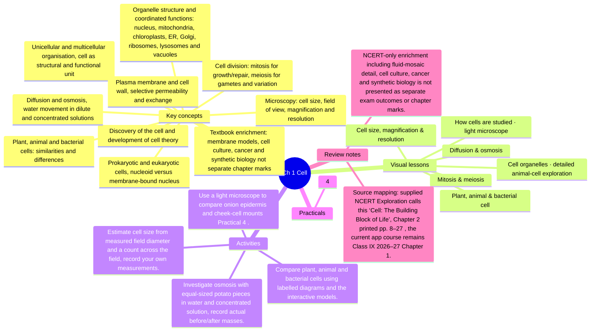

**Learning outcomes**

- Differentiate plant and animal cells; prokaryotic and eukaryotic cells
- Describe structural and functional features of cells and their role in organisms
- Explain activities inside a cell and its interaction with the environment
- Demonstrate osmosis; differentiate diffusion and osmosis
- Prepare slides to observe cell structure (practical 4)
- Explain the role of mitosis and meiosis in creating similarities and variations
- Identify the role of biomolecules in cell structure and function
- Case study: Leigh syndrome and mitochondrial dysfunction
- Apply muscle-cell / joint structure to dance and sports
- Indian contribution: Professor Arun Kumar Sharma — chromosomes and methods for their study
- Design low-cost, eco-friendly models of cells and organelles
- Open question: can an artificial cell behave exactly like a natural living cell?

### IX · Ch 2 — Tissues

*World of living* · पादप व जंतु ऊतक, संगठन के स्तर और अस्थि-पेशी तंत्र।

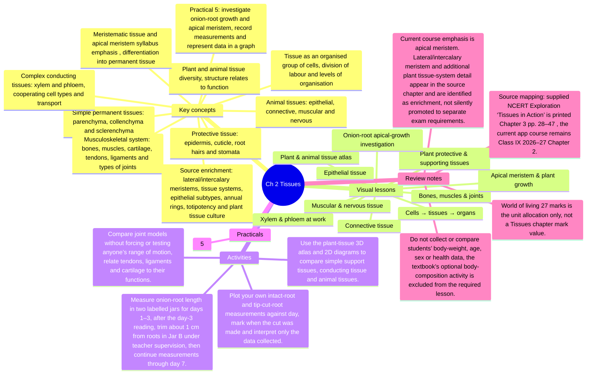

**Learning outcomes**

- Differentiate plant and animal tissues; meristematic and permanent; simple and complex
- Identify parenchyma, collenchyma, sclerenchyma; xylem and phloem
- Differentiate striated, smooth and cardiac muscle
- Identify different types of joints
- Relate tissue structure to function; describe organisation of a multicellular organism
- Correlate muscle, cartilage and bone in movement and fitness
- Explain yoga’s importance for agility and correct posture
- Indian contributors: Professors Sipra Guha Mukherjee and S. C. Maheshwari (plant tissue culture)
- Discuss techniques and medical recommendations for recovery from muscular injuries
- Experiment: plant growth due to the apical meristem; represent data in tables/graphs

### IX · Ch 3 — Reproduction

*World of living* · पादपों व मनुष्यों में अलैंगिक व लैंगिक जनन; जनन स्वास्थ्य।

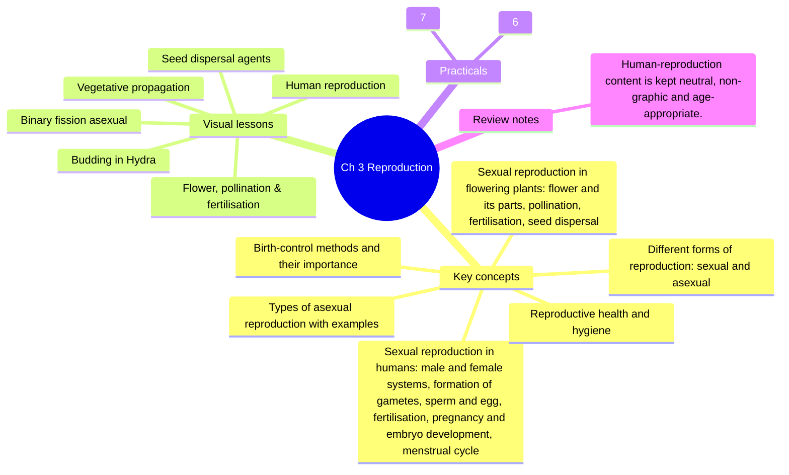

**Learning outcomes**

- Analyse interactions between plants and pollinators
- Compare sexual and asexual reproduction
- Describe male and female reproductive organs in plants and animals
- Differentiate ovule and seed; ovary and fruit
- Explain pollination and fertilisation; how sexual reproduction introduces variation
- Identify biotic and abiotic agents in pollination and seed dispersal
- Recognise the significance of contraceptive devices for population control and health
- India’s contribution to understanding human anatomy; Professor Panchanan Maheshwari (plant embryology / tissue culture)
- Recognise improvements in assisted reproductive technologies
- Open questions: do heavy metals harm reproductive organs? can extreme heat affect fertility?

### IX · Ch 4 — Diversity

*World of living* · वर्गीकरण क्यों: पाँच जगत, द्विनाम पद्धति, वायरस और पारिस्थितिक भूमिकाएँ।

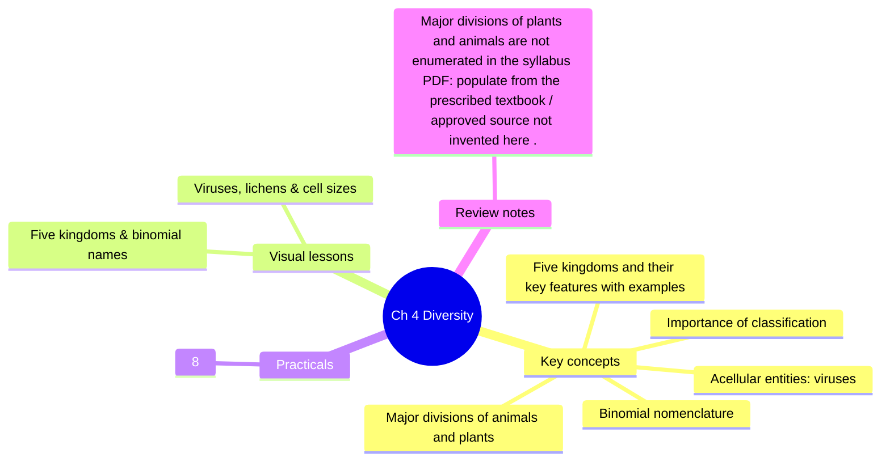

**Learning outcomes**

- Distinguish organisms by number of cells, cellular organisation and mode of nutrition
- Classify organisms into five kingdoms by cellular organisation and ecological role
- Explain the significance and rules of binomial nomenclature; apply it to local organisms
- Analyse interactions between groups of organisms, e.g. lichens
- Discuss the ecological roles of diverse organisms
- Recognise the three domains of classification on a molecular basis

### IX · Ch 5 — Exploring Mixtures and their Separation

*Matter* · विलयन, निलंबन, कोलॉइड; सांद्रता; पृथक्करण की छह विधियाँ।

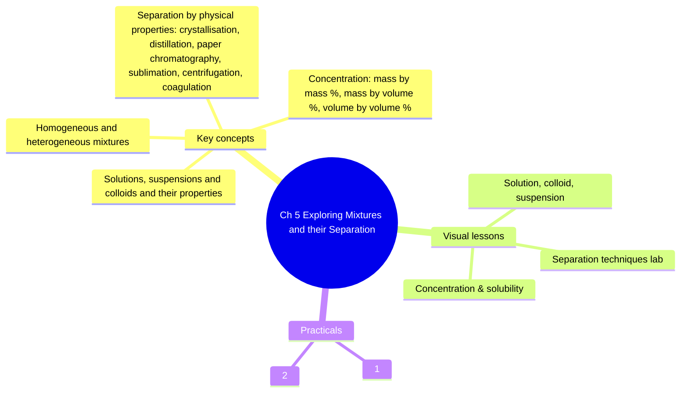

**Learning outcomes**

- Differentiate homogeneous and heterogeneous mixtures
- Demonstrate the six separation techniques
- Classify mixtures as solutions, suspensions or colloids
- Explain the scientific principle behind each technique; apply to everyday life
- Define and calculate all three percentage concentrations; use standard units
- Analyse solubility graphs and temperature effects
- Handle common laboratory chemicals and apparatus safely
- Relate separation to local environmental practices; traditional distillation
- Draw labelled apparatus diagrams and flowcharts
- Relate centrifugation to spinning dance
- Indian scientist: Dilip Mahalanabis; micro-scale crystallisation of copper sulfate
- Create eco-friendly models: paperfuge, distillation unit
- Open question: can artificial blood work for all patients?

### IX · Ch 6 — Structure of an Atom

*Matter* · उप-परमाण्विक कण, थॉमसन, रदरफोर्ड, बोर मॉडल, Z, A, समस्थानिक, समभारिक।

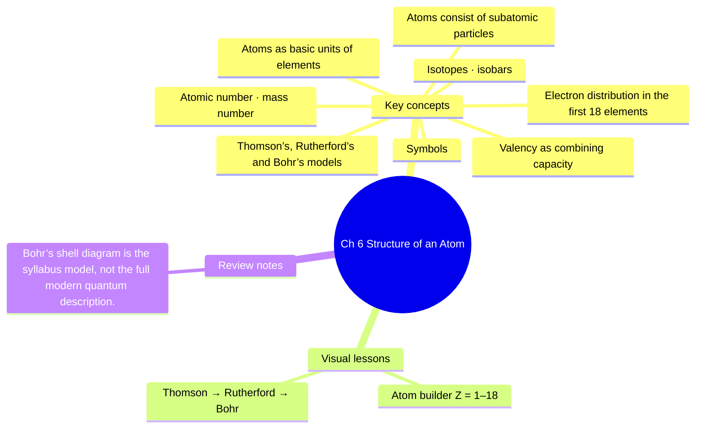

**Learning outcomes**

- Differentiate electrons, protons and neutrons by charge and position
- Illustrate electron distribution in shells K, L, M, N (n = 1, 2, 3, 4)
- Explain valence electrons, valency, atomic number, atomic mass, isotopes, isobars
- Calculate electrons, protons and neutrons from Z and A
- Interpret atomic-mass data and shell capacity to classify elements
- Use standard notation for electron, proton, neutron and the unified atomic mass unit (u)
- Apply IUPAC symbols to the first 18 elements
- Draw labelled Thomson, Rutherford and Bohr models; ‘Journey Inside the Atom’ role-play
- Indian contributions for peaceful purposes; Acharya Kanad — parmanu
- Societal uses: isotopes in medicine, atomic energy in power
- Design element-identification games
- Open question: can everything inside an atom be completely understood?

### IX · Ch 7 — Atoms and Molecules

*Matter* · द्रव्यमान के नियम, डाल्टन सिद्धांत, अणु, आयन, सूत्र व आण्विक द्रव्यमान।

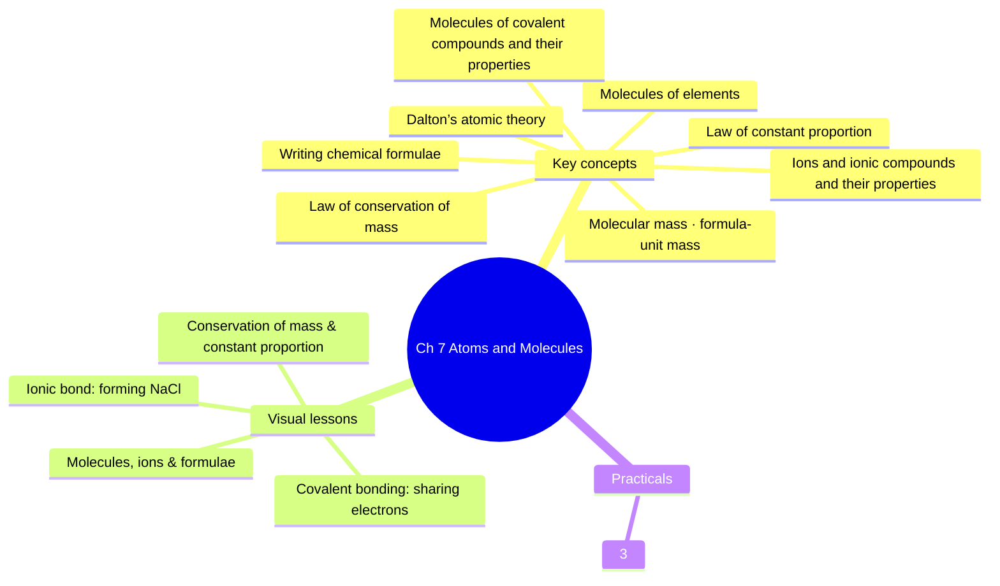

**Learning outcomes**

- Differentiate atoms/molecules, elements/compounds, ionic/covalent compounds, cations/anions, formula-unit/molecular mass
- Plan and demonstrate activities verifying conservation of mass (practical 3)
- Explain Dalton’s theory, constant proportions and ionic/covalent compound formation
- Calculate ion charge, valency from atomic number, molecular mass and formula-unit mass
- Write formulae of simple compounds from symbols and valencies
- Recognise Lavoisier, Proust and Dalton
- Draw electron-dot structures of atoms and molecules
- Beneficial uses of atoms/molecules in medicine and energy; relate atomic bonding to social bonding
- Design educational games for formula writing
- Indian context: peaceful atomic energy; traditional red pigment cinnabar
- Open question: are there changes that do not obey conservation of mass?

### IX · Ch 8 — Earth as a System: Energy, Matter & Life

*Earth as a system* · पृथ्वी के मंडल, सौर ऊर्जा, विभेदी तापन, पवन व जैव-भू-रासायनिक चक्र।

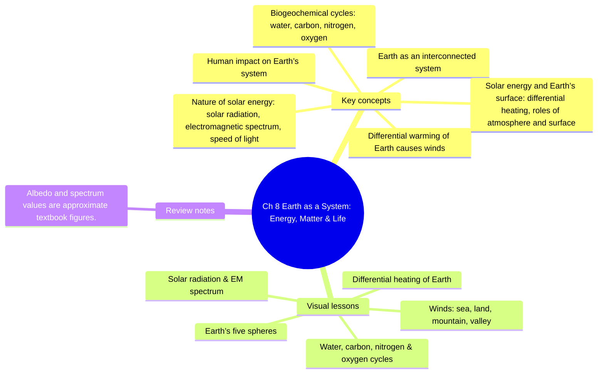

**Learning outcomes**

- Explain interconnections among biosphere, geosphere, hydrosphere, cryosphere, atmosphere
- Explain solar radiation as electromagnetic waves of different frequencies
- Explain differential heating by shape, latitude, tilt, absorption and reflection (albedo)
- Relate heating to air movement, evaporation, mountain/valley and sea/land breezes
- Explain the atmosphere’s role in weather and climate; identify reflectivity of materials from reliable sources
- Describe recycling of carbon, nitrogen, oxygen and water between biotic and abiotic environments
- Explain how cycles circulate matter and energy and maintain balance
- Reflect on changing conditions using traditional knowledge
- Draw flowcharts / concept maps; form hypotheses and predict outcomes
- Open question: what if Earth had no differential heating?

### IX · Ch 9 — Motion

*Motion, force, work & sound* · विस्थापन, वेग, त्वरण, ग्राफ़, गति के समीकरण और वृत्तीय गति।

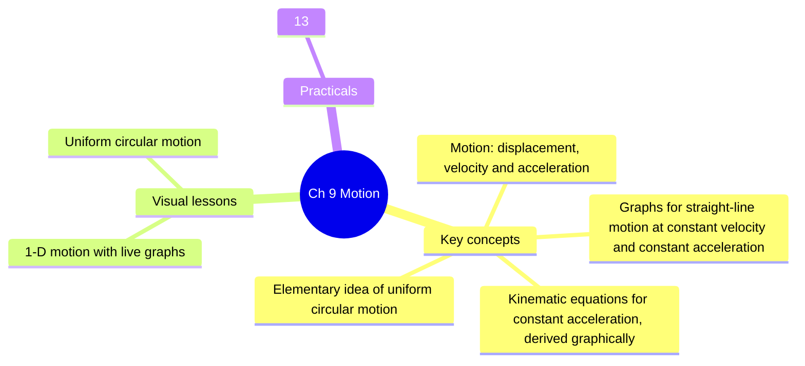

**Learning outcomes**

- Differentiate distance/displacement; speed/velocity; use SI units
- Plot and interpret position–time and velocity–time graphs
- Average velocity from s–t; displacement and average acceleration from v–t
- Derive kinematic equations graphically; calculate unknown quantities
- Derive the expression for speed in uniform circular motion
- Analyse real-life motion, identify and control variables (practical 13)

### IX · Ch 10 — Force and Laws of Motion

*Motion, force, work & sound* · संतुलित-असंतुलित बल, घर्षण और न्यूटन के तीन नियम।

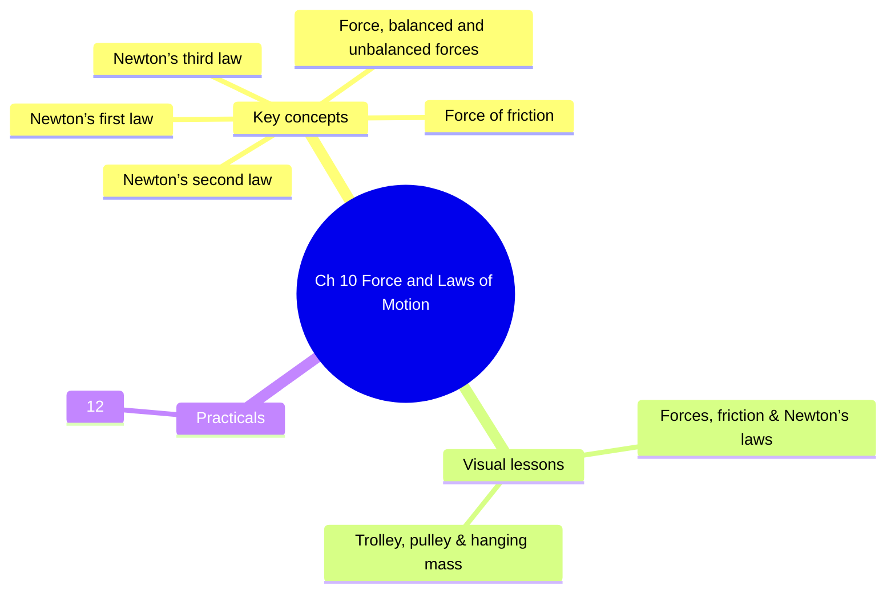

**Learning outcomes**

- Explain force as a vector
- Identify balanced and unbalanced situations; friction’s role
- Zero net force ⇒ constant velocity; net force ⇒ acceleration
- State and explain all three laws; F = ma; SI unit of force
- Apply the laws to everyday events
- Develop models, vary inputs and predict results (practical 12)

### IX · Ch 11 — Work, Energy and Simple Machines

*Motion, force, work & sound* · कार्य, ऊर्जा, ऊर्जा संरक्षण, शक्ति, लीवर, घिरनी, आनत तल।

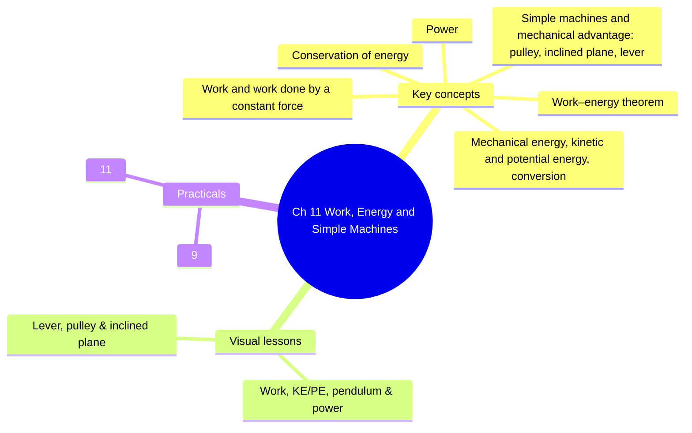

**Learning outcomes**

- Define work and its SI unit; calculate work
- State the work–energy theorem; energy and its SI unit
- Forms of energy and everyday interconversions
- Derive and use kinetic and gravitational potential energy expressions
- PE–KE conversion in free fall; law of conservation of energy
- Define and calculate power
- Identify pulley, inclined plane and lever; define and calculate M.A. (practicals 9, 11)

### IX · Ch 12 — Sound

*Motion, force, work & sound* · ध्वनि का उत्पादन व संचरण, तरंग गुण, प्रतिध्वनि व अनुरणन।

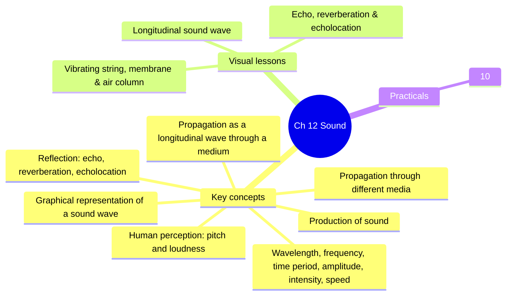

**Learning outcomes**

- Demonstrate sound production with strings, membranes and air columns
- Explain that sound needs a medium and travels as a longitudinal wave (air, solid, liquid)
- Describe and graph wavelength, frequency, period, amplitude, intensity, speed; analyse graphs
- Relate time period and frequency; derive and use the speed-of-sound expression
- Explain audible range, pitch and loudness
- Reflection, echo, reverberation, echolocation; music through loudness and pitch
- Gol Gumbaz whispering gallery; Sir C. V. Raman
- Develop models, vary factors and communicate conclusions (practical 10)

---

## Class X

### X · Ch 1 — Chemical Reactions and Equations

*Chemistry* · रासायनिक अभिक्रियाएँ एवं समीकरण

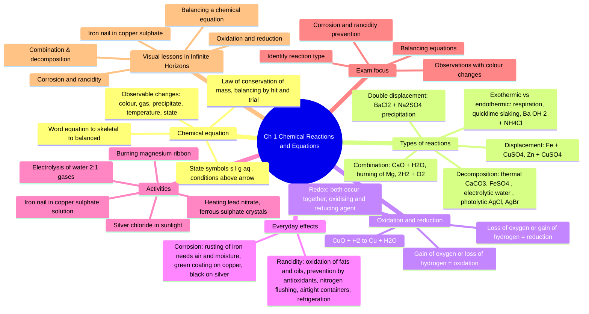

### X · Ch 2 — Acids, Bases and Salts

*Chemistry* · अम्ल, क्षार तथा लवण

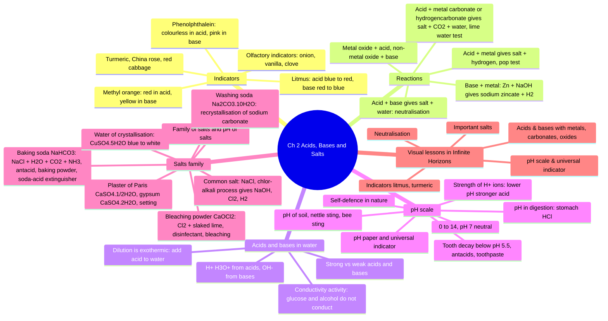

### X · Ch 3 — Metals and Non-metals

*Chemistry* · धातु एवं अधातु

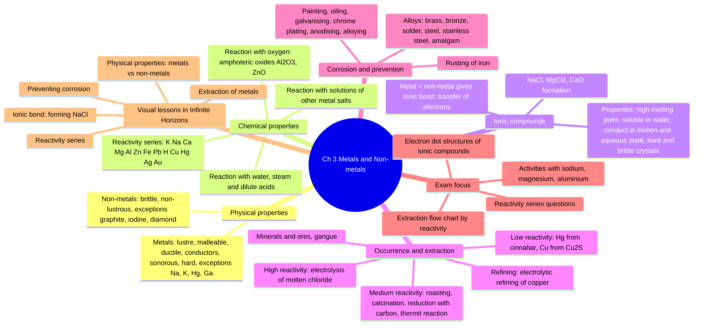

### X · Ch 4 — Carbon and its Compounds

*Chemistry* · कार्बन एवं उसके यौगिक

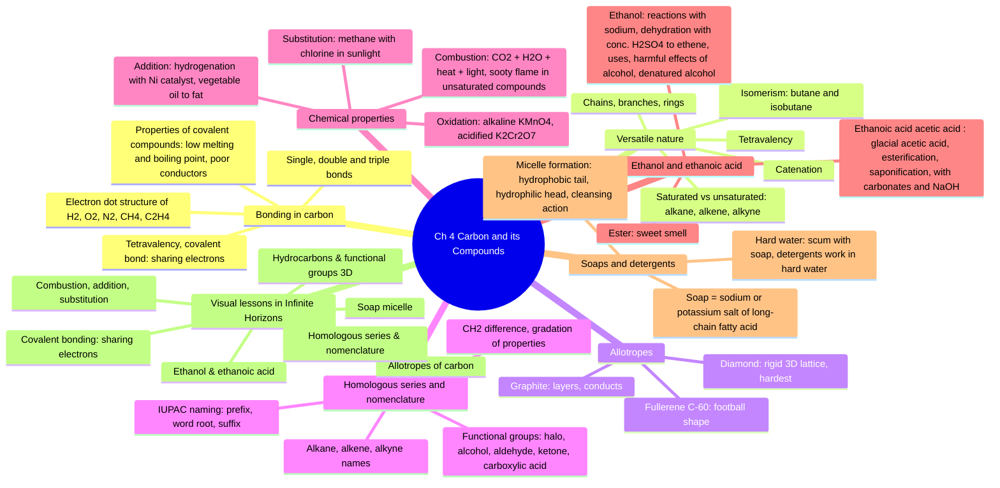

### X · Ch 5 — Life Processes

*Biology* · जैव प्रक्रम

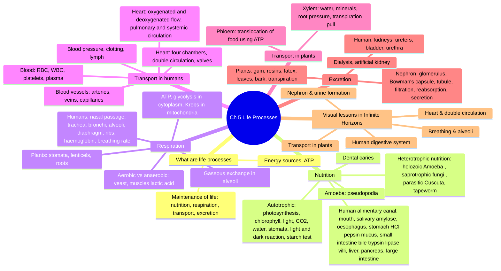

### X · Ch 6 — Control and Coordination

*Biology* · नियंत्रण एवं समन्वय

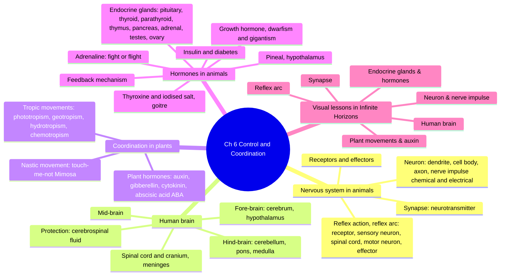

### X · Ch 7 — How do Organisms Reproduce?

*Biology* · जीव जनन कैसे करते हैं

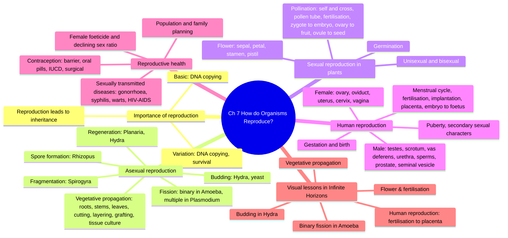

### X · Ch 8 — Heredity

*Biology* · आनुवंशिकता

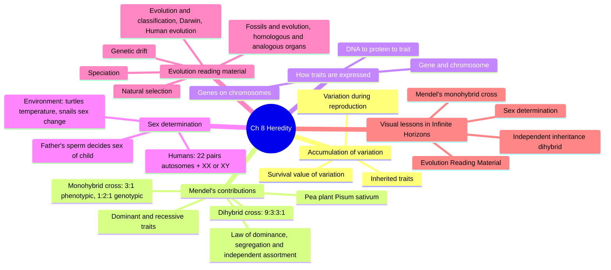

### X · Ch 9 — Light – Reflection and Refraction

*Physics* · प्रकाश – परावर्तन तथा अपवर्तन

```mermaid
mindmap
  root((Ch 9 Light – Reflection and Refraction))
    Reflection
      Laws: angle of incidence = angle of reflection, incident ray, reflected ray, normal in one plane
      Plane mirror image: virtual, erect, same size, laterally inverted
    Spherical mirrors
      Concave and convex, pole, centre of curvature, radius, principal axis, focus, aperture
      f = R/2
      Ray diagrams: six positions of concave mirror
      Image of convex mirror
      Sign convention New Cartesian
      Mirror formula 1/v + 1/u = 1/f
      Magnification m = -v/u = h'/h
      Uses: headlights, shaving, rear view, dentist
    Refraction of light
      Rays bend at interface, speed changes
      Laws: Snell's law sin i / sin r = n
      Refractive index n = c/v, optical density
      Glass slab: lateral displacement, emergent ray parallel
    Spherical lenses
      Convex and concave, optical centre, focus, focal length
      Ray diagrams for convex lens, six cases, concave lens
      Lens formula 1/v - 1/u = 1/f
      Magnification m = v/u = h'/h
      Power P = 1/f in metres, unit dioptre, lens combination P = P1 + P2
    Exam focus
      Numericals on mirror and lens formula
      Ray diagrams
      Sign convention
      Refractive index of media
    Visual lessons in Infinite Horizons
      Laws of reflection plane mirror
      Image formation: mirrors & lenses
      Refraction through a glass slab
      Power of a lens
```

### X · Ch 10 — The Human Eye and the Colourful World

*Physics* · मानव नेत्र एवं रंग-बिरंगा संसार

```mermaid
mindmap
  root((Ch 10 The Human Eye and the Colourful World))
    Human eye
      Cornea, iris, pupil, lens, ciliary muscles, retina, rods and cones, optic nerve, aqueous and vitreous humour
      Image formed on retina real and inverted
      Power of accommodation
      Far point 25 cm near point, far point infinity
    Defects of vision and correction
      Myopia: near-sighted, concave lens
      Hypermetropia: far-sighted, convex lens
      Presbyopia: bifocal lens
      Cataract: surgery
    Refraction by prism and dispersion
      Angle of deviation, prism angle
      Dispersion: VIBGYOR, Newton
      Rainbow: water drops, dispersion, internal reflection, refraction
      Recombination with second prism
    Atmospheric refraction
      Twinkling of stars
      Advance sunrise and delayed sunset by about 2 minutes
      Planets do not twinkle
    Scattering of light
      Tyndall effect
      Blue colour of sky
      Reddening of sun at sunrise and sunset
      Danger signal red light
      Colour of clouds and deep sea
    Visual lessons in Infinite Horizons
      Structure of the human eye
      Accommodation & defects of vision
      Dispersion by a prism
      Scattering of light blue sky
```

### X · Ch 11 — Electricity

*Physics* · विद्युत

```mermaid
mindmap
  root((Ch 11 Electricity))
    Basic quantities
      Charge Q, current I = Q/t, ampere
      Potential difference V = W/Q, volt
      Electric circuit diagram symbols
      Ammeter in series, voltmeter in parallel
    Ohm's law
      V = IR, V-I graph straight line
      Resistance: ohm
    Resistance
      Factors: length, area, material, temperature
      R = rho l / A, resistivity: metals, alloys, insulators
      Alloys used in heating elements, high resistivity
    Combination of resistors
      Series: Rs = R1 + R2 + R3, same current
      Parallel: 1/Rp = 1/R1 + 1/R2 + 1/R3, same voltage
      Domestic circuits in parallel
    Heating effect
      Joule's law: H = I2 R t
      Applications: electric heater, iron, bulb, fuse
    Electric power
      P = VI = I2R = V2/R, watt
      Energy: kilowatt-hour, 1 kWh = 3.6 x 10^6 J
    Visual lessons in Infinite Horizons
      Ohm's law circuit
      Factors affecting resistance
      Resistors in series & parallel
      Heating effect & power
```

### X · Ch 12 — Magnetic Effects of Electric Current

*Physics* · विद्युत धारा के चुंबकीय प्रभाव

```mermaid
mindmap
  root((Ch 12 Magnetic Effects of Electric Current))
    Magnetic field and field lines
      Oersted experiment
      Bar magnet: field lines from N to S outside, closed loops, do not intersect, crowded near poles
      Compass needle
    Field due to current
      Straight conductor: right-hand thumb rule, concentric circles
      Circular loop: field at the centre, depends on current, number of turns, radius
      Solenoid: field like bar magnet, electromagnet, core of soft iron
    Force on a conductor
      Current-carrying conductor in a field experiences force
      Fleming's left-hand rule: thumb force, forefinger field, middle finger current
      Maximum when perpendicular
    Applications
      Electric motor: split ring commutator, brushes, armature
      Loudspeaker, microphone, MRI
      Galvanometer
      DC and AC concepts
    Electromagnetic induction
      Faraday, moving magnet near coil induces current
      Fleming's right-hand rule
      Electric generator: AC, slip rings, DC with commutator
      AC: 50 Hz, reverses direction every 1/100 s
    Domestic electric circuits
      Live red , neutral black , earth green
      Main supply 220 V, 50 Hz, fuse, earth wire, overloading, short circuit
      MCB
    Visual lessons in Infinite Horizons
      Bar magnet: field lines
      Field around a straight wire
      Electromagnetic induction
      Circular loop & solenoid
      Force on a conductor Fleming's left-hand rule
      Domestic electric circuits
      Electric motor & generator Reading Material
```

### X · Ch 13 — Our Environment

*Environment* · हमारा पर्यावरण

```mermaid
mindmap
  root((Ch 13 Our Environment))
    Ecosystem
      Biotic and abiotic
      Producers, consumers, decomposers
      Natural vs artificial ecosystem: forest, pond, garden, crop field
    Food chains and webs
      Food chain: grass to deer to lion, trophic levels
      Food web: interlinked chains
      Energy flow: 10 per cent law
      Biological magnification: pesticides, DDT, accumulation of non-biodegradable chemicals
    Ozone layer
      O3 absorbs UV
      Chlorofluorocarbons CFCs deplete ozone, refrigerators, aerosols
      UNEP 1987 CFC reduction
    Garbage disposal
      Biodegradable: paper, food waste, dead plants
      Non-biodegradable: plastics, glass, metals, DDT
      Waste management, recycling, landfills, reduce reuse recycle
    Visual lessons in Infinite Horizons
      Energy flow & 10% law
      Food web
      Ozone layer depletion
      Biodegradable vs non-biodegradable
```

<!-- 12 Class IX + 13 Class X chapters -->
