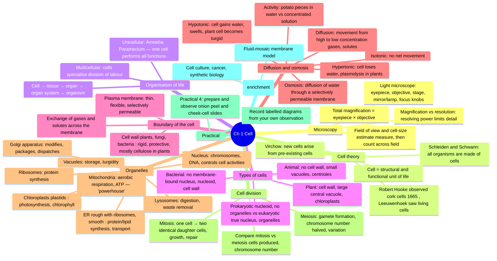

# Class IX · Ch 1 — Cell

*World of living* · जीवन की इकाई कोशिका: कोशिकांग, झिल्ली, परासरण, समसूत्री व अर्धसूत्री विभाजन।

## Microscopy

- Light microscope: eyepiece, objective, stage, mirror/lamp, focus knobs
- Total magnification = eyepiece × objective
- Field of view and cell-size estimate (measure, then count across field)
- Magnification vs resolution: resolving power limits detail

## Cell theory

- Robert Hooke observed cork cells (1665); Leeuwenhoek saw living cells
- Schleiden and Schwann: all organisms are made of cells
- Virchow: new cells arise from pre-existing cells
- Cell = structural and functional unit of life

## Organisation of life

- Unicellular: Amoeba, Paramecium — one cell performs all functions
- Multicellular: cells specialise (division of labour)
- Cell → tissue → organ → organ system → organism

## Types of cells

- Plant: cell wall, large central vacuole, chloroplasts
- Animal: no cell wall, small vacuoles, centrioles
- Bacterial: no membrane-bound nucleus; nucleoid; cell wall
- Prokaryotic (nucleoid, no organelles) vs eukaryotic (true nucleus, organelles)

## Boundary of the cell

- Plasma membrane: thin, flexible, selectively permeable
- Cell wall (plants, fungi, bacteria): rigid, protective, mostly cellulose in plants
- Exchange of gases and solutes across the membrane

## Diffusion and osmosis

- Diffusion: movement from high to low concentration (gases, solutes)
- Osmosis: diffusion of water through a selectively permeable membrane
- Hypotonic: cell gains water, swells; plant cell becomes turgid
- Isotonic: no net movement
- Hypertonic: cell loses water; plasmolysis in plants
- Activity: potato pieces in water vs concentrated solution

## Organelles

- Nucleus: chromosomes, DNA, controls cell activities
- Mitochondria: aerobic respiration, ATP — 'powerhouse'
- Chloroplasts (plastids): photosynthesis, chlorophyll
- ER (rough with ribosomes, smooth): protein/lipid synthesis, transport
- Golgi apparatus: modifies, packages, dispatches
- Ribosomes: protein synthesis
- Lysosomes: digestion, waste removal
- Vacuoles: storage, turgidity

## Cell division

- Mitosis: one cell → two identical daughter cells; growth, repair
- Meiosis: gamete formation; chromosome number halved; variation
- Compare mitosis vs meiosis (cells produced, chromosome number)

## Practical

- Practical 4: prepare and observe onion peel and cheek-cell slides
- Record labelled diagrams from your own observation

## Enrichment (not separate marks) _(enrichment, not separate marks)_

- Fluid-mosaic membrane model
- Cell culture, cancer, synthetic biology

## Learning outcomes

- Differentiate plant and animal cells; prokaryotic and eukaryotic cells
- Describe structural and functional features of cells and their role in organisms
- Explain activities inside a cell and its interaction with the environment
- Demonstrate osmosis; differentiate diffusion and osmosis
- Prepare slides to observe cell structure (practical 4)
- Explain the role of mitosis and meiosis in creating similarities and variations
- Identify the role of biomolecules in cell structure and function
- Case study: Leigh syndrome and mitochondrial dysfunction
- Apply muscle-cell / joint structure to dance and sports
- Indian contribution: Professor Arun Kumar Sharma — chromosomes and methods for their study
- Design low-cost, eco-friendly models of cells and organelles
- Open question: can an artificial cell behave exactly like a natural living cell?

## Activities

- Use a light microscope to compare onion epidermis and cheek-cell mounts (Practical 4).
- Estimate cell size from measured field diameter and a count across the field; record your own measurements.
- Investigate osmosis with equal-sized potato pieces in water and concentrated solution; record actual before/after masses.
- Compare plant, animal and bacterial cells using labelled diagrams and the interactive models.

## Practicals

- Practical 4

## Visual lessons in the app

- Plant, animal & bacterial cell
- Diffusion & osmosis
- Mitosis & meiosis
- How cells are studied · light microscope
- Cell size, magnification & resolution
- Cell organelles · detailed animal-cell exploration

## Review notes

- Source mapping: supplied NCERT Exploration calls this ‘Cell: The Building Block of Life’, Chapter 2 (printed pp. 8–27); the current app course remains Class IX 2026–27 Chapter 1.
- NCERT-only enrichment (including fluid-mosaic detail, cell culture, cancer and synthetic biology) is not presented as separate exam outcomes or chapter marks.
