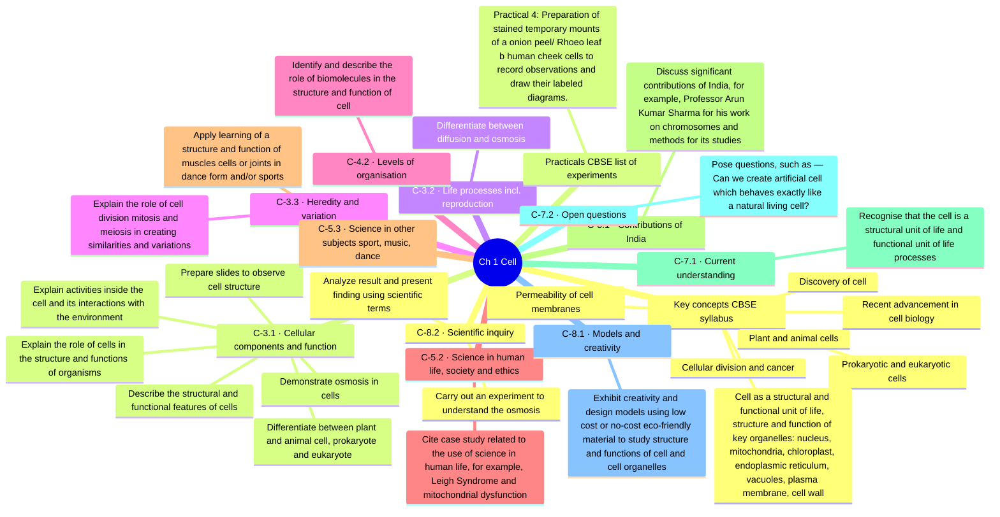

# Class IX · Ch 1 (CBSE ch 2, 12 periods) — Cell

*World of living* · जीवन की इकाई कोशिका: कोशिकांग, झिल्ली, परासरण, समसूत्री व अर्धसूत्री विभाजन।

## Key concepts (CBSE syllabus) _(CBSE key concept)_

- Discovery of cell
- Plant and animal cells
- Prokaryotic and eukaryotic cells
- Cell as a structural and functional unit of life; structure and function of key organelles: nucleus, mitochondria, chloroplast, endoplasmic reticulum, vacuoles, plasma membrane, cell wall
- Permeability of cell membranes
- Cellular division and cancer
- Recent advancement in cell biology

## C-3.1 · Cellular components and function _(CBSE learning outcomes)_

- Differentiate between plant and animal cell, prokaryote and eukaryote
- Describe the structural and functional features of cells
- Explain the role of cells in the structure and functions of organisms
- Explain activities inside the cell and its interactions with the environment
- Demonstrate osmosis in cells
- Prepare slides to observe cell structure

## C-3.2 · Life processes (incl. reproduction) _(CBSE learning outcomes)_

- Differentiate between diffusion and osmosis

## C-3.3 · Heredity and variation _(CBSE learning outcomes)_

- Explain the role of cell division mitosis and meiosis in creating similarities and variations

## C-4.2 · Levels of organisation _(CBSE learning outcomes)_

- Identify and describe the role of biomolecules in the structure and function of cell

## C-5.2 · Science in human life, society and ethics _(CBSE learning outcomes)_

- Cite case study related to the use of science in human life, for example, Leigh Syndrome and mitochondrial dysfunction

## C-5.3 · Science in other subjects (sport, music, dance) _(CBSE learning outcomes)_

- Apply learning of a structure and function of muscles cells or joints in dance form and/or sports

## C-6.1 · Contributions of India _(CBSE learning outcomes)_

- Discuss significant contributions of India, for example, Professor Arun Kumar Sharma for his work on chromosomes and methods for its studies

## C-7.1 · Current understanding _(CBSE learning outcomes)_

- Recognise that the cell is a structural unit of life and functional unit of life processes

## C-7.2 · Open questions _(CBSE learning outcomes)_

- Pose questions, such as — Can we create artificial cell which behaves exactly like a natural living cell?

## C-8.1 · Models and creativity _(CBSE learning outcomes)_

- Exhibit creativity and design models using low cost or no-cost eco-friendly material to study structure and functions of cell and cell organelles

## C-8.2 · Scientific inquiry _(CBSE learning outcomes)_

- Carry out an experiment to understand the osmosis
- Analyze result and present finding using scientific terms

## Practicals (CBSE list of experiments) _(CBSE practical)_

- Practical 4: Preparation of stained temporary mounts of (a) onion peel/ Rhoeo leaf (b) human cheek cells to record observations and draw their labeled diagrams.

## Visual lessons in the app

- Plant, animal & bacterial cell
- Diffusion & osmosis
- Mitosis & meiosis
- How cells are studied · light microscope
- Cell size, magnification & resolution
- Cell organelles · detailed animal-cell exploration
