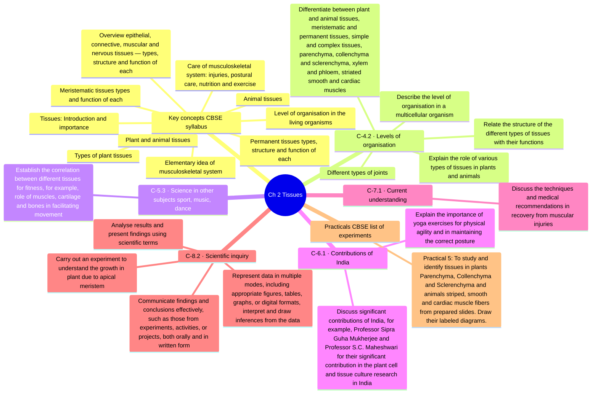

# Class IX · Ch 2 (CBSE ch 3, 13 periods) — Tissues

*World of living* · पादप व जंतु ऊतक, संगठन के स्तर और अस्थि-पेशी तंत्र।

## Key concepts (CBSE syllabus) _(CBSE key concept)_

- Tissues: Introduction and importance
- Level of organisation in the living organisms
- Plant and animal tissues
- Types of plant tissues
- Meristematic tissues (types and function of each)
- Permanent tissues (types, structure and function of each)
- Animal tissues
- Overview (epithelial, connective, muscular and nervous tissues — types, structure and function of each)
- Elementary idea of musculoskeletal system
- Care of musculoskeletal system: injuries, postural care, nutrition and exercise

## C-4.2 · Levels of organisation _(CBSE learning outcomes)_

- Differentiate between plant and animal tissues; meristematic and permanent tissues; simple and complex tissues; parenchyma, collenchyma and sclerenchyma; xylem and phloem; striated smooth and cardiac muscles
- Different types of joints
- Relate the structure of the different types of tissues with their functions
- Explain the role of various types of tissues in plants and animals
- Describe the level of organisation in a multicellular organism

## C-5.3 · Science in other subjects (sport, music, dance) _(CBSE learning outcomes)_

- Establish the correlation between different tissues for fitness, for example, role of muscles, cartilage and bones in facilitating movement

## C-6.1 · Contributions of India _(CBSE learning outcomes)_

- Explain the importance of yoga exercises for physical agility and in maintaining the correct posture
- Discuss significant contributions of India, for example, Professor Sipra Guha Mukherjee and Professor S.C. Maheshwari for their significant contribution in the plant cell and tissue culture research in India

## C-7.1 · Current understanding _(CBSE learning outcomes)_

- Discuss the techniques and medical recommendations in recovery from muscular injuries

## C-8.2 · Scientific inquiry _(CBSE learning outcomes)_

- Carry out an experiment to understand the growth in plant due to apical meristem
- Represent data in multiple modes, including appropriate figures, tables, graphs, or digital formats, interpret and draw inferences from the data
- Analyse results and present findings using scientific terms
- Communicate findings and conclusions effectively, such as those from experiments, activities, or projects, both orally and in written form

## Practicals (CBSE list of experiments) _(CBSE practical)_

- Practical 5: To study and identify tissues in plants (Parenchyma, Collenchyma and Sclerenchyma) and animals (striped, smooth and cardiac muscle fibers) from prepared slides. Draw their labeled diagrams.

## Visual lessons in the app

- Plant & animal tissue atlas
- Bones, muscles & joints
- Xylem & phloem at work
- Cells → tissues → organs
- Apical meristem & plant growth
- Plant protective & supporting tissues
- Epithelial tissue
- Connective tissue
- Muscular & nervous tissue
- Onion-root apical-growth investigation
