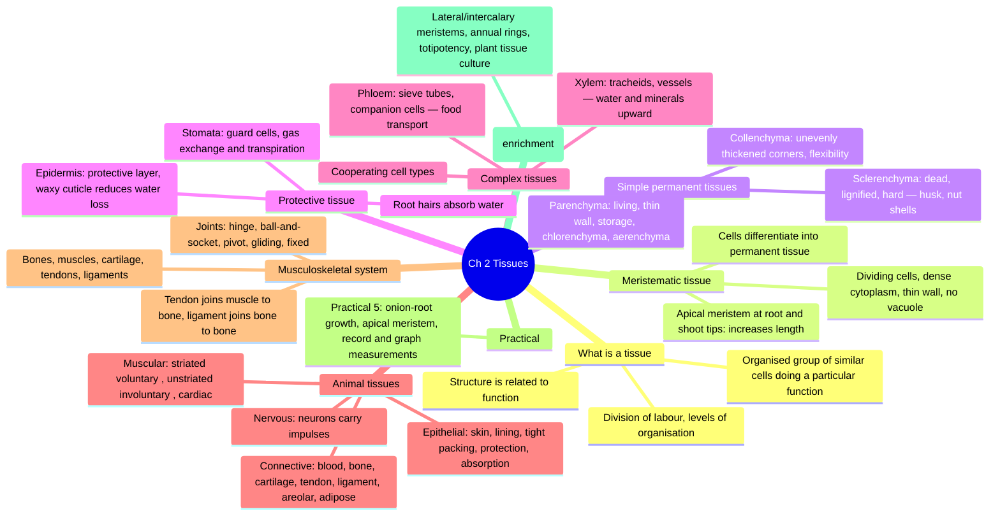

# Class IX · Ch 2 — Tissues

*World of living* · पादप व जंतु ऊतक, संगठन के स्तर और अस्थि-पेशी तंत्र।

## What is a tissue

- Organised group of similar cells doing a particular function
- Division of labour; levels of organisation
- Structure is related to function

## Meristematic tissue

- Dividing cells; dense cytoplasm, thin wall, no vacuole
- Apical meristem at root and shoot tips: increases length
- Cells differentiate into permanent tissue

## Simple permanent tissues

- Parenchyma: living, thin wall, storage; chlorenchyma; aerenchyma
- Collenchyma: unevenly thickened corners, flexibility
- Sclerenchyma: dead, lignified, hard — husk, nut shells

## Protective tissue

- Epidermis: protective layer; waxy cuticle reduces water loss
- Root hairs absorb water
- Stomata: guard cells, gas exchange and transpiration

## Complex tissues

- Xylem: tracheids, vessels — water and minerals upward
- Phloem: sieve tubes, companion cells — food transport
- Cooperating cell types

## Animal tissues

- Epithelial: skin, lining; tight packing, protection, absorption
- Connective: blood, bone, cartilage, tendon, ligament, areolar, adipose
- Muscular: striated (voluntary), unstriated (involuntary), cardiac
- Nervous: neurons carry impulses

## Musculoskeletal system

- Bones, muscles, cartilage, tendons, ligaments
- Joints: hinge, ball-and-socket, pivot, gliding, fixed
- Tendon joins muscle to bone; ligament joins bone to bone

## Practical

- Practical 5: onion-root growth, apical meristem; record and graph measurements

## Enrichment (not separate marks) _(enrichment, not separate marks)_

- Lateral/intercalary meristems, annual rings, totipotency, plant tissue culture

## Learning outcomes

- Differentiate plant and animal tissues; meristematic and permanent; simple and complex
- Identify parenchyma, collenchyma, sclerenchyma; xylem and phloem
- Differentiate striated, smooth and cardiac muscle
- Identify different types of joints
- Relate tissue structure to function; describe organisation of a multicellular organism
- Correlate muscle, cartilage and bone in movement and fitness
- Explain yoga’s importance for agility and correct posture
- Indian contributors: Professors Sipra Guha Mukherjee and S. C. Maheshwari (plant tissue culture)
- Discuss techniques and medical recommendations for recovery from muscular injuries
- Experiment: plant growth due to the apical meristem; represent data in tables/graphs

## Activities

- Measure onion-root length in two labelled jars for days 1–3; after the day-3 reading, trim about 1 cm from roots in Jar B under teacher supervision, then continue measurements through day 7.
- Plot your own intact-root and tip-cut-root measurements against day; mark when the cut was made and interpret only the data collected.
- Use the plant-tissue 3D atlas and 2D diagrams to compare simple support tissues, conducting tissue and animal tissues.
- Compare joint models without forcing or testing anyone’s range of motion; relate tendons, ligaments and cartilage to their functions.

## Practicals

- Practical 5

## Visual lessons in the app

- Plant & animal tissue atlas
- Bones, muscles & joints
- Xylem & phloem at work
- Cells → tissues → organs
- Apical meristem & plant growth
- Plant protective & supporting tissues
- Epithelial tissue
- Connective tissue
- Muscular & nervous tissue
- Onion-root apical-growth investigation

## Review notes

- Source mapping: supplied NCERT Exploration ‘Tissues in Action’ is printed Chapter 3 (pp. 28–47); the current app course remains Class IX 2026–27 Chapter 2.
- Current course emphasis is apical meristem. Lateral/intercalary meristem and additional plant tissue-system detail appear in the source chapter and are identified as enrichment, not silently promoted to separate exam requirements.
- Do not collect or compare students’ body-weight, age, sex or health data; the textbook’s optional body-composition activity is excluded from the required lesson.
- World of living 27 marks is the unit allocation only, not a Tissues chapter mark value.
