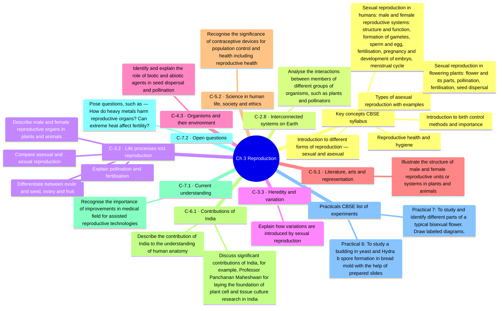

# Class IX · Ch 3 (CBSE ch 11, 13 periods) — Reproduction

*World of living* · पादपों व मनुष्यों में अलैंगिक व लैंगिक जनन; जनन स्वास्थ्य।

## Key concepts (CBSE syllabus) _(CBSE key concept)_

- Introduction to different forms of reproduction — sexual and asexual
- Types of asexual reproduction with examples
- Sexual reproduction in flowering plants: flower and its parts, pollination, fertilisation, seed dispersal
- Sexual reproduction in humans: male and female reproductive systems: structure and function, formation of gametes, sperm and egg, fertilisation, pregnancy and development of embryo, menstrual cycle
- Reproductive health and hygiene
- Introduction to birth control methods and importance

## C-2.8 · Interconnected systems on Earth _(CBSE learning outcomes)_

- Analyse the interactions between members of different groups of organisms, such as plants and pollinators

## C-3.2 · Life processes (incl. reproduction) _(CBSE learning outcomes)_

- Compare asexual and sexual reproduction
- Describe male and female reproductive organs in plants and animals
- Differentiate between ovule and seed; ovary and fruit
- Explain pollination and fertilisation

## C-3.3 · Heredity and variation _(CBSE learning outcomes)_

- Explain how variations are introduced by sexual reproduction

## C-4.3 · Organisms and their environment _(CBSE learning outcomes)_

- Identify and explain the role of biotic and abiotic agents in seed dispersal and pollination

## C-5.1 · Literature, arts and representation _(CBSE learning outcomes)_

- Illustrate the structure of male and female reproductive units or systems in plants and animals

## C-5.2 · Science in human life, society and ethics _(CBSE learning outcomes)_

- Recognise the significance of contraceptive devices for population control and health including reproductive health

## C-6.1 · Contributions of India _(CBSE learning outcomes)_

- Describe the contribution of India to the understanding of human anatomy
- Discuss significant contributions of India, for example, Professor Panchanan Maheshwari for laying the foundation of plant cell and tissue culture research in India

## C-7.1 · Current understanding _(CBSE learning outcomes)_

- Recognise the importance of improvements in medical field for assisted reproductive technologies

## C-7.2 · Open questions _(CBSE learning outcomes)_

- Pose questions, such as — How do heavy metals harm reproductive organs? Can extreme heat affect fertility?

## Practicals (CBSE list of experiments) _(CBSE practical)_

- Practical 6: To study (a) budding in yeast and Hydra (b) spore formation in bread mold with the help of prepared slides
- Practical 7: To study and identify different parts of a typical bisexual flower. Draw labeled diagrams.

## Visual lessons in the app

- Binary fission (asexual)
- Budding in Hydra
- Vegetative propagation
- Flower, pollination & fertilisation
- Seed dispersal agents
- Human reproduction
