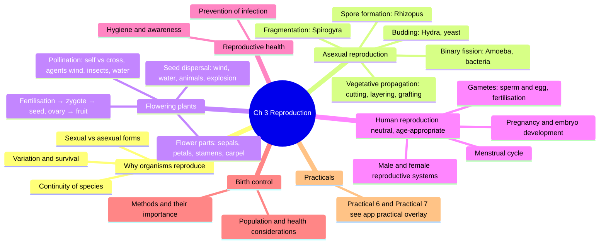

# Class IX · Ch 3 — Reproduction

*World of living* · पादपों व मनुष्यों में अलैंगिक व लैंगिक जनन; जनन स्वास्थ्य।

## Why organisms reproduce

- Continuity of species
- Variation and survival
- Sexual vs asexual forms

## Asexual reproduction

- Binary fission: Amoeba, bacteria
- Budding: Hydra, yeast
- Fragmentation: Spirogyra
- Spore formation: Rhizopus
- Vegetative propagation: cutting, layering, grafting

## Flowering plants

- Flower parts: sepals, petals, stamens, carpel
- Pollination: self vs cross; agents wind, insects, water
- Fertilisation → zygote → seed; ovary → fruit
- Seed dispersal: wind, water, animals, explosion

## Human reproduction (neutral, age-appropriate)

- Male and female reproductive systems
- Gametes: sperm and egg; fertilisation
- Pregnancy and embryo development
- Menstrual cycle

## Reproductive health

- Hygiene and awareness
- Prevention of infection

## Birth control

- Methods and their importance
- Population and health considerations

## Practicals

- Practical 6 and Practical 7 (see app practical overlay)

## Learning outcomes

- Analyse interactions between plants and pollinators
- Compare sexual and asexual reproduction
- Describe male and female reproductive organs in plants and animals
- Differentiate ovule and seed; ovary and fruit
- Explain pollination and fertilisation; how sexual reproduction introduces variation
- Identify biotic and abiotic agents in pollination and seed dispersal
- Recognise the significance of contraceptive devices for population control and health
- India’s contribution to understanding human anatomy; Professor Panchanan Maheshwari (plant embryology / tissue culture)
- Recognise improvements in assisted reproductive technologies
- Open questions: do heavy metals harm reproductive organs? can extreme heat affect fertility?

## Practicals

- Practical 6
- Practical 7

## Visual lessons in the app

- Binary fission (asexual)
- Budding in Hydra
- Vegetative propagation
- Flower, pollination & fertilisation
- Seed dispersal agents
- Human reproduction

## Review notes

- Human-reproduction content is kept neutral, non-graphic and age-appropriate.
