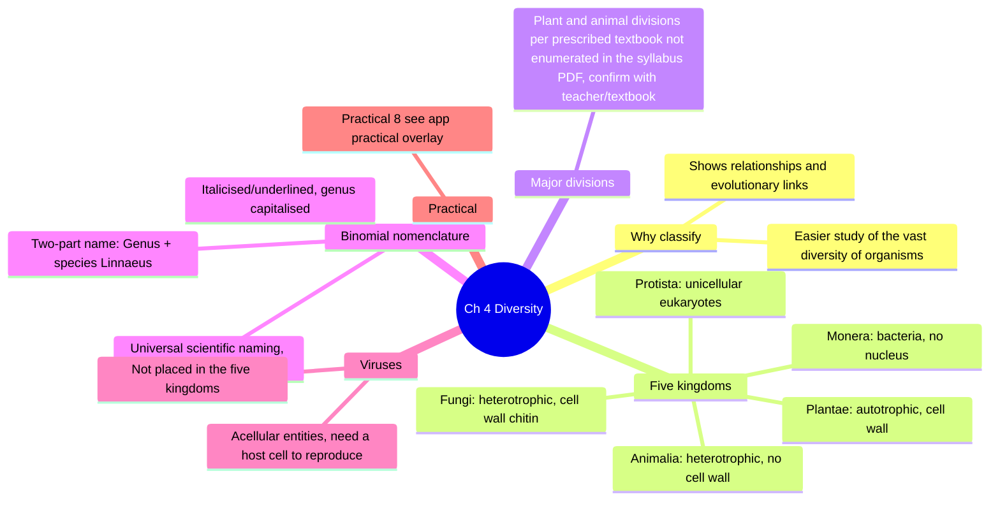

# Class IX · Ch 4 — Diversity

*World of living* · वर्गीकरण क्यों: पाँच जगत, द्विनाम पद्धति, वायरस और पारिस्थितिक भूमिकाएँ।

## Why classify

- Easier study of the vast diversity of organisms
- Shows relationships and evolutionary links

## Five kingdoms

- Monera: bacteria, no nucleus
- Protista: unicellular eukaryotes
- Fungi: heterotrophic, cell wall (chitin)
- Plantae: autotrophic, cell wall
- Animalia: heterotrophic, no cell wall

## Major divisions _(confirm with textbook/teacher)_

- Plant and animal divisions per prescribed textbook (not enumerated in the syllabus PDF; confirm with teacher/textbook)

## Binomial nomenclature

- Two-part name: Genus + species (Linnaeus)
- Italicised/underlined; genus capitalised
- Universal scientific naming; example Homo sapiens

## Viruses

- Acellular entities; need a host cell to reproduce
- Not placed in the five kingdoms

## Practical

- Practical 8 (see app practical overlay)

## Learning outcomes

- Distinguish organisms by number of cells, cellular organisation and mode of nutrition
- Classify organisms into five kingdoms by cellular organisation and ecological role
- Explain the significance and rules of binomial nomenclature; apply it to local organisms
- Analyse interactions between groups of organisms, e.g. lichens
- Discuss the ecological roles of diverse organisms
- Recognise the three domains of classification on a molecular basis

## Practicals

- Practical 8

## Visual lessons in the app

- Five kingdoms & binomial names
- Viruses, lichens & cell sizes

## Review notes

- Major divisions of plants and animals are not enumerated in the syllabus PDF: populate from the prescribed textbook / approved source (not invented here).
