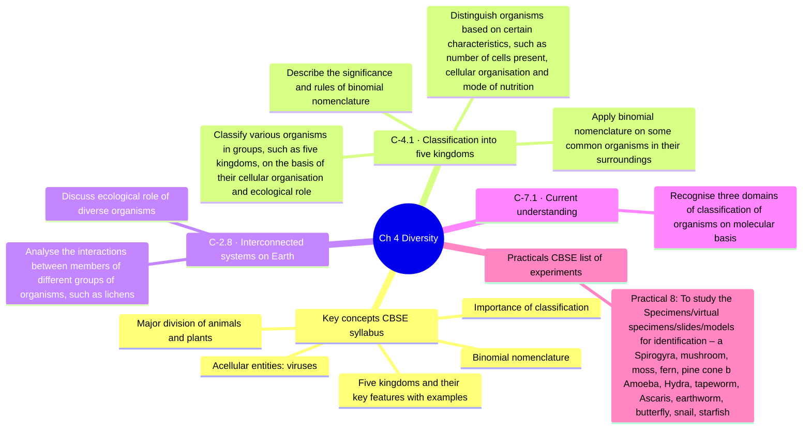

# Class IX · Ch 4 (CBSE ch 12, 12 periods) — Diversity

*World of living* · वर्गीकरण क्यों: पाँच जगत, द्विनाम पद्धति, वायरस और पारिस्थितिक भूमिकाएँ।

## Key concepts (CBSE syllabus) _(CBSE key concept)_

- Importance of classification
- Five kingdoms and their key features with examples
- Major division of animals and plants
- Binomial nomenclature
- Acellular entities: viruses

## C-4.1 · Classification into five kingdoms _(CBSE learning outcomes)_

- Distinguish organisms based on certain characteristics, such as number of cells present, cellular organisation and mode of nutrition
- Classify various organisms in groups, such as five kingdoms, on the basis of their cellular organisation and ecological role
- Describe the significance and rules of binomial nomenclature
- Apply binomial nomenclature on some common organisms in their surroundings

## C-2.8 · Interconnected systems on Earth _(CBSE learning outcomes)_

- Analyse the interactions between members of different groups of organisms, such as lichens
- Discuss ecological role of diverse organisms

## C-7.1 · Current understanding _(CBSE learning outcomes)_

- Recognise three domains of classification of organisms on molecular basis

## Practicals (CBSE list of experiments) _(CBSE practical)_

- Practical 8: To study the Specimens/virtual specimens/slides/models for identification – (a) Spirogyra, mushroom, moss, fern, pine cone (b) Amoeba, Hydra, tapeworm, Ascaris, earthworm, butterfly, snail, starfish

## Visual lessons in the app

- Five kingdoms & binomial names
- Viruses, lichens & cell sizes
