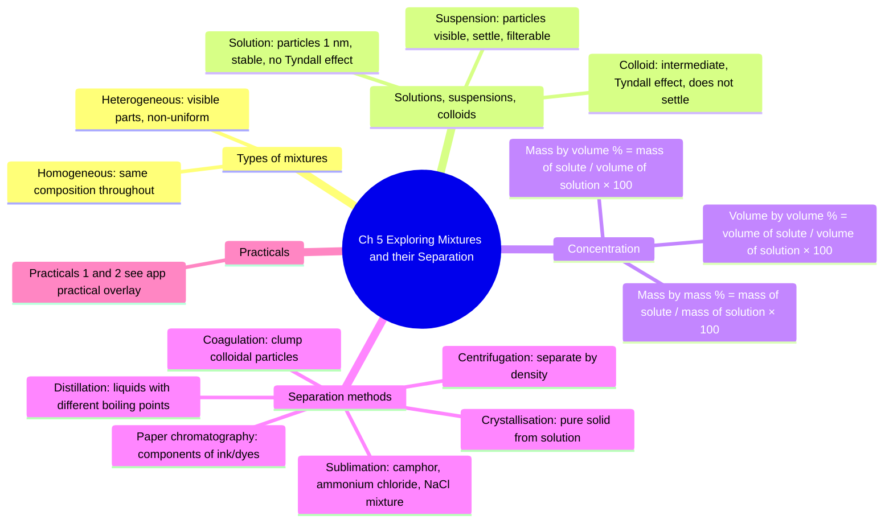

# Class IX · Ch 5 — Exploring Mixtures and their Separation

*Matter* · विलयन, निलंबन, कोलॉइड; सांद्रता; पृथक्करण की छह विधियाँ।

## Types of mixtures

- Homogeneous: same composition throughout
- Heterogeneous: visible parts, non-uniform

## Solutions, suspensions, colloids

- Solution: particles < 1 nm, stable, no Tyndall effect
- Suspension: particles visible, settle, filterable
- Colloid: intermediate; Tyndall effect, does not settle

## Concentration

- Mass by mass % = (mass of solute / mass of solution) × 100
- Mass by volume % = (mass of solute / volume of solution) × 100
- Volume by volume % = (volume of solute / volume of solution) × 100

## Separation methods

- Crystallisation: pure solid from solution
- Distillation: liquids with different boiling points
- Paper chromatography: components of ink/dyes
- Sublimation: camphor, ammonium chloride, NaCl mixture
- Centrifugation: separate by density
- Coagulation: clump colloidal particles

## Practicals

- Practicals 1 and 2 (see app practical overlay)

## Learning outcomes

- Differentiate homogeneous and heterogeneous mixtures
- Demonstrate the six separation techniques
- Classify mixtures as solutions, suspensions or colloids
- Explain the scientific principle behind each technique; apply to everyday life
- Define and calculate all three percentage concentrations; use standard units
- Analyse solubility graphs and temperature effects
- Handle common laboratory chemicals and apparatus safely
- Relate separation to local environmental practices; traditional distillation
- Draw labelled apparatus diagrams and flowcharts
- Relate centrifugation to spinning dance
- Indian scientist: Dilip Mahalanabis; micro-scale crystallisation of copper sulfate
- Create eco-friendly models: paperfuge, distillation unit
- Open question: can artificial blood work for all patients?

## Practicals

- Practical 1
- Practical 2

## Visual lessons in the app

- Solution, colloid, suspension
- Separation techniques lab
- Concentration & solubility
