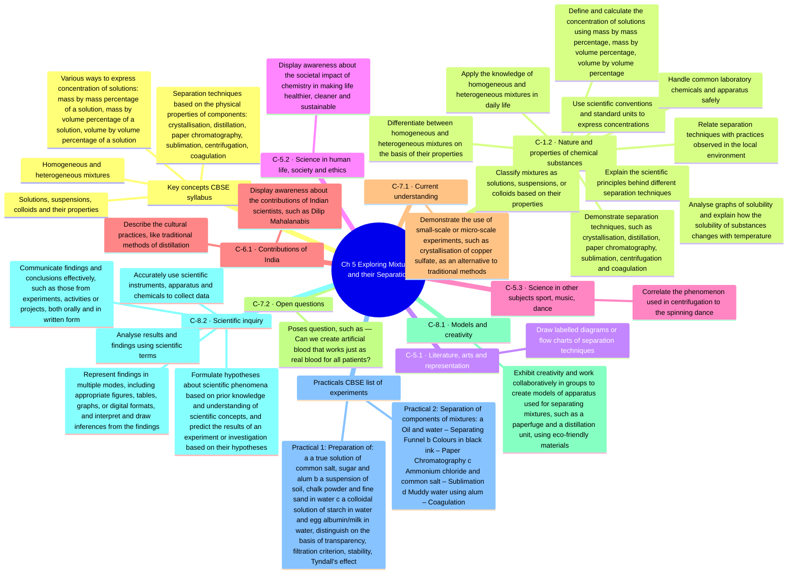

# Class IX · Ch 5 (CBSE ch 5, 12 periods) — Exploring Mixtures and their Separation

*Matter* · विलयन, निलंबन, कोलॉइड; सांद्रता; पृथक्करण की छह विधियाँ।

## Key concepts (CBSE syllabus) _(CBSE key concept)_

- Homogeneous and heterogeneous mixtures
- Solutions, suspensions, colloids and their properties
- Various ways to express concentration of solutions: mass by mass percentage of a solution, mass by volume percentage of a solution, volume by volume percentage of a solution
- Separation techniques based on the physical properties of components: crystallisation, distillation, paper chromatography, sublimation, centrifugation, coagulation

## C-1.2 · Nature and properties of chemical substances _(CBSE learning outcomes)_

- Differentiate between homogeneous and heterogeneous mixtures on the basis of their properties
- Demonstrate separation techniques, such as crystallisation, distillation, paper chromatography, sublimation, centrifugation and coagulation
- Classify mixtures as solutions, suspensions, or colloids based on their properties
- Explain the scientific principles behind different separation techniques
- Apply the knowledge of homogeneous and heterogeneous mixtures in daily life
- Define and calculate the concentration of solutions using mass by mass percentage, mass by volume percentage, volume by volume percentage
- Analyse graphs of solubility and explain how the solubility of substances changes with temperature
- Use scientific conventions and standard units to express concentrations
- Handle common laboratory chemicals and apparatus safely
- Relate separation techniques with practices observed in the local environment

## C-5.1 · Literature, arts and representation _(CBSE learning outcomes)_

- Draw labelled diagrams or flow charts of separation techniques

## C-5.2 · Science in human life, society and ethics _(CBSE learning outcomes)_

- Display awareness about the societal impact of chemistry in making life healthier, cleaner and sustainable

## C-5.3 · Science in other subjects (sport, music, dance) _(CBSE learning outcomes)_

- Correlate the phenomenon used in centrifugation to the spinning dance

## C-6.1 · Contributions of India _(CBSE learning outcomes)_

- Describe the cultural practices, like traditional methods of distillation
- Display awareness about the contributions of Indian scientists, such as Dilip Mahalanabis

## C-7.1 · Current understanding _(CBSE learning outcomes)_

- Demonstrate the use of small-scale or micro-scale experiments, such as crystallisation of copper sulfate, as an alternative to traditional methods

## C-7.2 · Open questions _(CBSE learning outcomes)_

- Poses question, such as — Can we create artificial blood that works just as real blood for all patients?

## C-8.1 · Models and creativity _(CBSE learning outcomes)_

- Exhibit creativity and work collaboratively in groups to create models of apparatus used for separating mixtures, such as a paperfuge and a distillation unit, using eco-friendly materials

## C-8.2 · Scientific inquiry _(CBSE learning outcomes)_

- Formulate hypotheses about scientific phenomena based on prior knowledge and understanding of scientific concepts, and predict the results of an experiment or investigation based on their hypotheses
- Accurately use scientific instruments, apparatus and chemicals to collect data
- Analyse results and findings using scientific terms
- Represent findings in multiple modes, including appropriate figures, tables, graphs, or digital formats, and interpret and draw inferences from the findings
- Communicate findings and conclusions effectively, such as those from experiments, activities or projects, both orally and in written form

## Practicals (CBSE list of experiments) _(CBSE practical)_

- Practical 1: Preparation of: (a) a true solution of common salt, sugar and alum (b) a suspension of soil, chalk powder and fine sand in water (c) a colloidal solution of starch in water and egg albumin/milk in water; distinguish on the basis of transparency, filtration criterion, stability, Tyndall's effect
- Practical 2: Separation of components of mixtures: (a) Oil and water – Separating Funnel (b) Colours in black ink – Paper Chromatography (c) Ammonium chloride and common salt – Sublimation (d) Muddy water using alum – Coagulation

## Visual lessons in the app

- Solution, colloid, suspension
- Separation techniques lab
- Concentration & solubility
