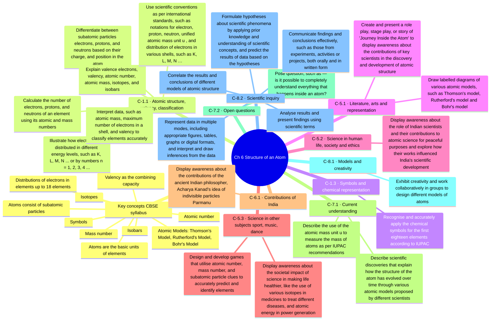

# Class IX · Ch 6 (CBSE ch 8, 14 periods) — Structure of an Atom

*Matter* · उप-परमाण्विक कण, थॉमसन, रदरफोर्ड, बोर मॉडल, Z, A, समस्थानिक, समभारिक।

## Key concepts (CBSE syllabus) _(CBSE key concept)_

- Atoms are the basic units of elements
- Atoms consist of subatomic particles
- Atomic Models: Thomson's Model, Rutherford's Model, Bohr's Model
- Distributions of electrons in elements (up to 18 elements)
- Symbols
- Valency as the combining capacity
- Atomic number
- Mass number
- Isotopes
- Isobars

## C-1.1 · Atomic structure, valency, classification _(CBSE learning outcomes)_

- Differentiate between subatomic particles (electrons, protons, and neutrons) based on their charge, and position in the atom
- Illustrate how electrons are distributed in different energy levels, such as K, L, M, N ... or by numbers n = 1, 2, 3, 4 ...
- Explain valence electrons, valency, atomic number, atomic mass, isotopes, and isobars
- Calculate the number of electrons, protons, and neutrons of an element using its atomic and mass numbers
- Interpret data, such as atomic mass, maximum number of electrons in a shell, and valency to classify elements accurately
- Use scientific conventions as per international standards, such as notations for electron, proton, neutron, unified atomic mass unit (u), and distribution of electrons in various shells, such as K, L, M, N …

## C-1.3 · Symbols and chemical representation _(CBSE learning outcomes)_

- Recognise and accurately apply the chemical symbols for the first eighteen elements according to IUPAC

## C-5.1 · Literature, arts and representation _(CBSE learning outcomes)_

- Draw labelled diagrams of various atomic models, such as Thomson's model, Rutherford's model and Bohr's model
- Create and present a role play, stage play, or story of 'Journey Inside the Atom' to display awareness about the contributions of key scientists in the discovery and development of atomic structure

## C-5.2 · Science in human life, society and ethics _(CBSE learning outcomes)_

- Display awareness about the role of Indian scientists and their contributions to atomic science for peaceful purposes and explore how their works influenced India's scientific development

## C-5.3 · Science in other subjects (sport, music, dance) _(CBSE learning outcomes)_

- Display awareness about the societal impact of science in making life healthier, like the use of various isotopes in medicines to treat different diseases, and atomic energy in power generation
- Design and develop games that utilise atomic number, mass number, and subatomic particle clues to accurately predict and identify elements

## C-6.1 · Contributions of India _(CBSE learning outcomes)_

- Display awareness about the contributions of the ancient Indian philosopher, Acharya Kanad's idea of indivisible particles (Parmanu)

## C-7.1 · Current understanding _(CBSE learning outcomes)_

- Describe the use of the atomic mass unit (u) to measure the mass of atoms as per IUPAC recommendations
- Describe scientific discoveries that explain how the structure of the atom has evolved over time through various atomic models proposed by different scientists

## C-7.2 · Open questions _(CBSE learning outcomes)_

- Pose question, such as — is it possible to completely understand everything that happens inside an atom?

## C-8.1 · Models and creativity _(CBSE learning outcomes)_

- Exhibit creativity and work collaboratively in groups to design different models of atoms

## C-8.2 · Scientific inquiry _(CBSE learning outcomes)_

- Formulate hypotheses about scientific phenomena by applying prior knowledge and understanding of scientific concepts, and predict the results of data based on the hypotheses
- Analyse results and present findings using scientific terms
- Correlate the results and conclusions of different models of atomic structure
- Represent data in multiple modes, including appropriate figures, tables, graphs or digital formats, and interpret and draw inferences from the data
- Communicate findings and conclusions effectively, such as those from experiments, activities or projects, both orally and in written form

## Visual lessons in the app

- Atom builder (Z = 1–18)
- Thomson → Rutherford → Bohr
