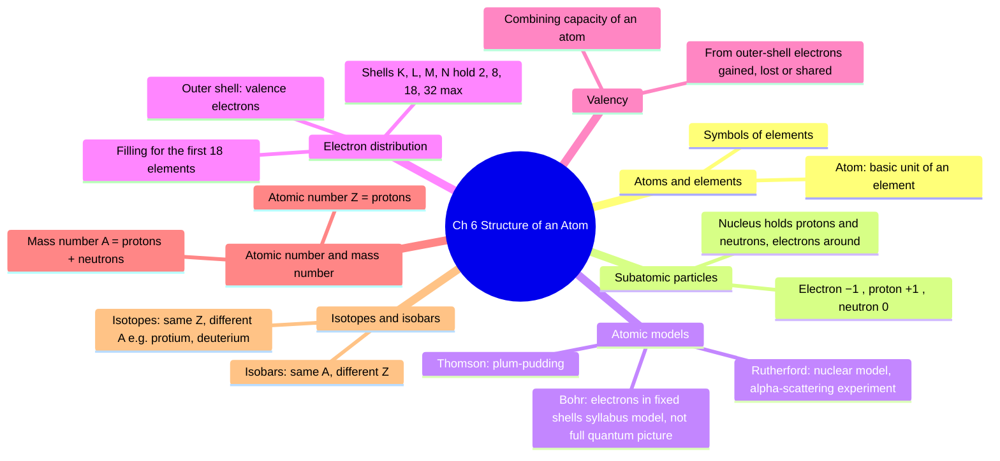

# Class IX · Ch 6 — Structure of an Atom

*Matter* · उप-परमाण्विक कण, थॉमसन, रदरफोर्ड, बोर मॉडल, Z, A, समस्थानिक, समभारिक।

## Atoms and elements

- Atom: basic unit of an element
- Symbols of elements

## Subatomic particles

- Electron (−1), proton (+1), neutron (0)
- Nucleus holds protons and neutrons; electrons around

## Atomic models

- Thomson: plum-pudding
- Rutherford: nuclear model; alpha-scattering experiment
- Bohr: electrons in fixed shells (syllabus model, not full quantum picture)

## Electron distribution

- Shells K, L, M, N hold 2, 8, 18, 32 (max)
- Filling for the first 18 elements
- Outer shell: valence electrons

## Valency

- Combining capacity of an atom
- From outer-shell electrons gained, lost or shared

## Atomic number and mass number

- Atomic number Z = protons
- Mass number A = protons + neutrons

## Isotopes and isobars

- Isotopes: same Z, different A (e.g. protium, deuterium)
- Isobars: same A, different Z

## Learning outcomes

- Differentiate electrons, protons and neutrons by charge and position
- Illustrate electron distribution in shells K, L, M, N (n = 1, 2, 3, 4)
- Explain valence electrons, valency, atomic number, atomic mass, isotopes, isobars
- Calculate electrons, protons and neutrons from Z and A
- Interpret atomic-mass data and shell capacity to classify elements
- Use standard notation for electron, proton, neutron and the unified atomic mass unit (u)
- Apply IUPAC symbols to the first 18 elements
- Draw labelled Thomson, Rutherford and Bohr models; ‘Journey Inside the Atom’ role-play
- Indian contributions for peaceful purposes; Acharya Kanad — parmanu
- Societal uses: isotopes in medicine, atomic energy in power
- Design element-identification games
- Open question: can everything inside an atom be completely understood?

## Visual lessons in the app

- Atom builder (Z = 1–18)
- Thomson → Rutherford → Bohr

## Review notes

- Bohr’s shell diagram is the syllabus model, not the full modern quantum description.
