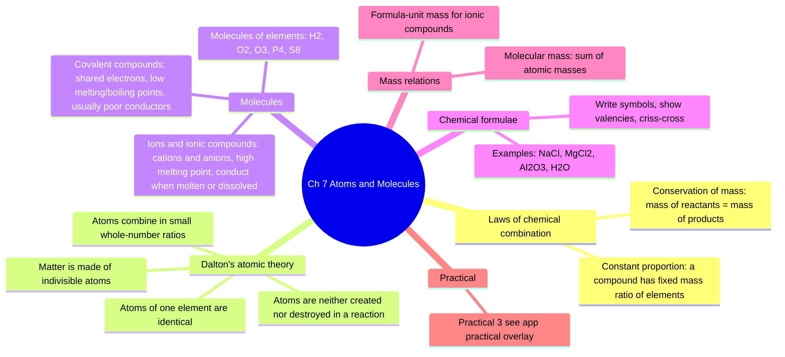

# Class IX · Ch 7 — Atoms and Molecules

*Matter* · द्रव्यमान के नियम, डाल्टन सिद्धांत, अणु, आयन, सूत्र व आण्विक द्रव्यमान।

## Laws of chemical combination

- Conservation of mass: mass of reactants = mass of products
- Constant proportion: a compound has fixed mass ratio of elements

## Dalton's atomic theory

- Matter is made of indivisible atoms
- Atoms of one element are identical
- Atoms combine in small whole-number ratios
- Atoms are neither created nor destroyed in a reaction

## Molecules

- Molecules of elements: H2, O2, O3, P4, S8
- Covalent compounds: shared electrons; low melting/boiling points; usually poor conductors
- Ions and ionic compounds: cations and anions; high melting point; conduct when molten or dissolved

## Chemical formulae

- Write symbols, show valencies, criss-cross
- Examples: NaCl, MgCl2, Al2O3, H2O

## Mass relations

- Molecular mass: sum of atomic masses
- Formula-unit mass for ionic compounds

## Practical

- Practical 3 (see app practical overlay)

## Learning outcomes

- Differentiate atoms/molecules, elements/compounds, ionic/covalent compounds, cations/anions, formula-unit/molecular mass
- Plan and demonstrate activities verifying conservation of mass (practical 3)
- Explain Dalton’s theory, constant proportions and ionic/covalent compound formation
- Calculate ion charge, valency from atomic number, molecular mass and formula-unit mass
- Write formulae of simple compounds from symbols and valencies
- Recognise Lavoisier, Proust and Dalton
- Draw electron-dot structures of atoms and molecules
- Beneficial uses of atoms/molecules in medicine and energy; relate atomic bonding to social bonding
- Design educational games for formula writing
- Indian context: peaceful atomic energy; traditional red pigment cinnabar
- Open question: are there changes that do not obey conservation of mass?

## Practicals

- Practical 3

## Visual lessons in the app

- Conservation of mass & constant proportion
- Molecules, ions & formulae
- Ionic bond: forming NaCl
- Covalent bonding: sharing electrons
