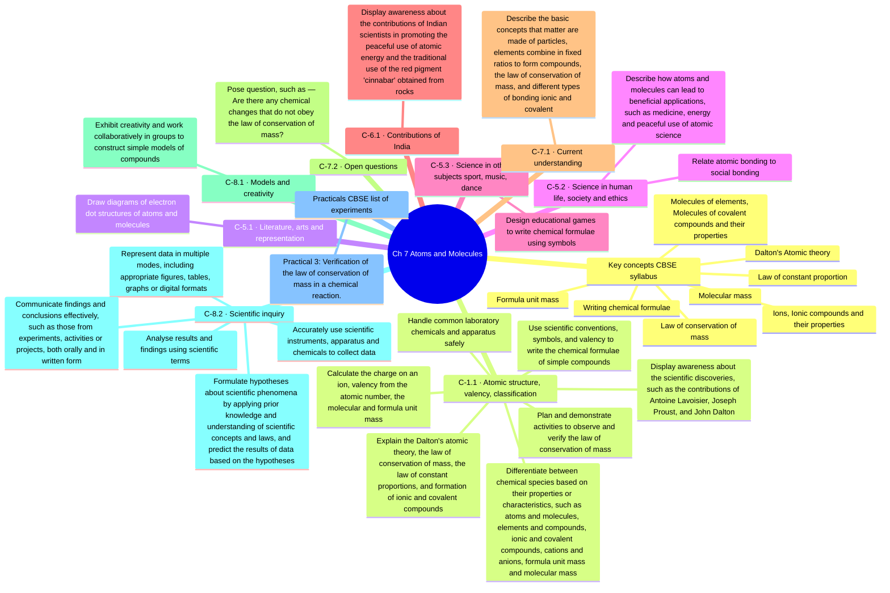

# Class IX · Ch 7 (CBSE ch 9, 14 periods) — Atoms and Molecules

*Matter* · द्रव्यमान के नियम, डाल्टन सिद्धांत, अणु, आयन, सूत्र व आण्विक द्रव्यमान।

## Key concepts (CBSE syllabus) _(CBSE key concept)_

- Law of conservation of mass
- Law of constant proportion
- Dalton's Atomic theory
- Molecules of elements, Molecules of covalent compounds and their properties
- Ions, Ionic compounds and their properties
- Writing chemical formulae
- Molecular mass
- Formula unit mass

## C-1.1 · Atomic structure, valency, classification _(CBSE learning outcomes)_

- Differentiate between chemical species based on their properties or characteristics, such as atoms and molecules, elements and compounds, ionic and covalent compounds, cations and anions, formula unit mass and molecular mass
- Plan and demonstrate activities to observe and verify the law of conservation of mass
- Explain the Dalton's atomic theory, the law of conservation of mass, the law of constant proportions, and formation of ionic and covalent compounds
- Calculate the charge on an ion, valency from the atomic number, the molecular and formula unit mass
- Use scientific conventions, symbols, and valency to write the chemical formulae of simple compounds
- Display awareness about the scientific discoveries, such as the contributions of Antoine Lavoisier, Joseph Proust, and John Dalton
- Handle common laboratory chemicals and apparatus safely

## C-5.1 · Literature, arts and representation _(CBSE learning outcomes)_

- Draw diagrams of electron dot structures of atoms and molecules

## C-5.2 · Science in human life, society and ethics _(CBSE learning outcomes)_

- Describe how atoms and molecules can lead to beneficial applications, such as medicine, energy and peaceful use of atomic science
- Relate atomic bonding to social bonding

## C-5.3 · Science in other subjects (sport, music, dance) _(CBSE learning outcomes)_

- Design educational games to write chemical formulae using symbols

## C-6.1 · Contributions of India _(CBSE learning outcomes)_

- Display awareness about the contributions of Indian scientists in promoting the peaceful use of atomic energy and the traditional use of the red pigment 'cinnabar' obtained from rocks

## C-7.1 · Current understanding _(CBSE learning outcomes)_

- Describe the basic concepts that matter are made of particles; elements combine in fixed ratios to form compounds; the law of conservation of mass; and different types of bonding (ionic and covalent)

## C-7.2 · Open questions _(CBSE learning outcomes)_

- Pose question, such as — Are there any chemical changes that do not obey the law of conservation of mass?

## C-8.1 · Models and creativity _(CBSE learning outcomes)_

- Exhibit creativity and work collaboratively in groups to construct simple models of compounds

## C-8.2 · Scientific inquiry _(CBSE learning outcomes)_

- Formulate hypotheses about scientific phenomena by applying prior knowledge and understanding of scientific concepts and laws, and predict the results of data based on the hypotheses
- Accurately use scientific instruments, apparatus and chemicals to collect data
- Analyse results and findings using scientific terms
- Represent data in multiple modes, including appropriate figures, tables, graphs or digital formats
- Communicate findings and conclusions effectively, such as those from experiments, activities or projects, both orally and in written form

## Practicals (CBSE list of experiments) _(CBSE practical)_

- Practical 3: Verification of the law of conservation of mass in a chemical reaction.

## Visual lessons in the app

- Conservation of mass & constant proportion
- Molecules, ions & formulae
- Ionic bond: forming NaCl
- Covalent bonding: sharing electrons
