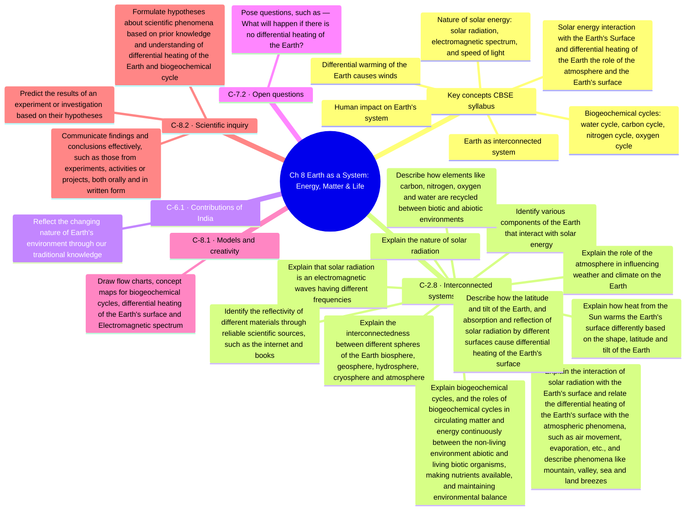

# Class IX · Ch 8 (CBSE ch 13, 12 periods) — Earth as a System: Energy, Matter & Life

*Earth as a system* · पृथ्वी के मंडल, सौर ऊर्जा, विभेदी तापन, पवन व जैव-भू-रासायनिक चक्र।

## Key concepts (CBSE syllabus) _(CBSE key concept)_

- Earth as interconnected system
- Nature of solar energy: solar radiation, electromagnetic spectrum, and speed of light
- Solar energy interaction with the Earth's Surface and differential heating of the Earth (the role of the atmosphere and the Earth's surface)
- Differential warming of the Earth causes winds
- Biogeochemical cycles: water cycle, carbon cycle, nitrogen cycle, oxygen cycle
- Human impact on Earth's system

## C-2.8 · Interconnected systems on Earth _(CBSE learning outcomes)_

- Explain the interconnectedness between different spheres of the Earth (biosphere, geosphere, hydrosphere, cryosphere and atmosphere)
- Explain the nature of solar radiation
- Explain that solar radiation is an electromagnetic waves having different frequencies
- Explain how heat from the Sun warms the Earth's surface differently based on the shape, latitude and tilt of the Earth
- Explain the interaction of solar radiation with the Earth's surface and relate the differential heating of the Earth's surface with the atmospheric phenomena, such as air movement, evaporation, etc., and describe phenomena like mountain, valley, sea and land breezes
- Describe how the latitude and tilt of the Earth, and absorption and reflection of solar radiation by different surfaces cause differential heating of the Earth's surface
- Identify various components of the Earth that interact with solar energy
- Explain the role of the atmosphere in influencing weather and climate on the Earth
- Identify the reflectivity of different materials through reliable scientific sources, such as the internet and books
- Describe how elements like carbon, nitrogen, oxygen and water are recycled between biotic and abiotic environments
- Explain biogeochemical cycles, and the roles of biogeochemical cycles in circulating matter and energy continuously between the non-living environment (abiotic) and living (biotic) organisms, making nutrients available, and maintaining environmental balance

## C-6.1 · Contributions of India _(CBSE learning outcomes)_

- Reflect the changing nature of Earth's environment through our traditional knowledge

## C-7.2 · Open questions _(CBSE learning outcomes)_

- Pose questions, such as — What will happen if there is no differential heating of the Earth?

## C-8.1 · Models and creativity _(CBSE learning outcomes)_

- Draw flow charts, concept maps for biogeochemical cycles, differential heating of the Earth's surface and Electromagnetic spectrum

## C-8.2 · Scientific inquiry _(CBSE learning outcomes)_

- Formulate hypotheses about scientific phenomena based on prior knowledge and understanding of differential heating of the Earth and biogeochemical cycle
- Predict the results of an experiment or investigation based on their hypotheses
- Communicate findings and conclusions effectively, such as those from experiments, activities or projects, both orally and in written form

## Visual lessons in the app

- Earth’s five spheres
- Solar radiation & EM spectrum
- Differential heating of Earth
- Winds: sea, land, mountain, valley
- Water, carbon, nitrogen & oxygen cycles
