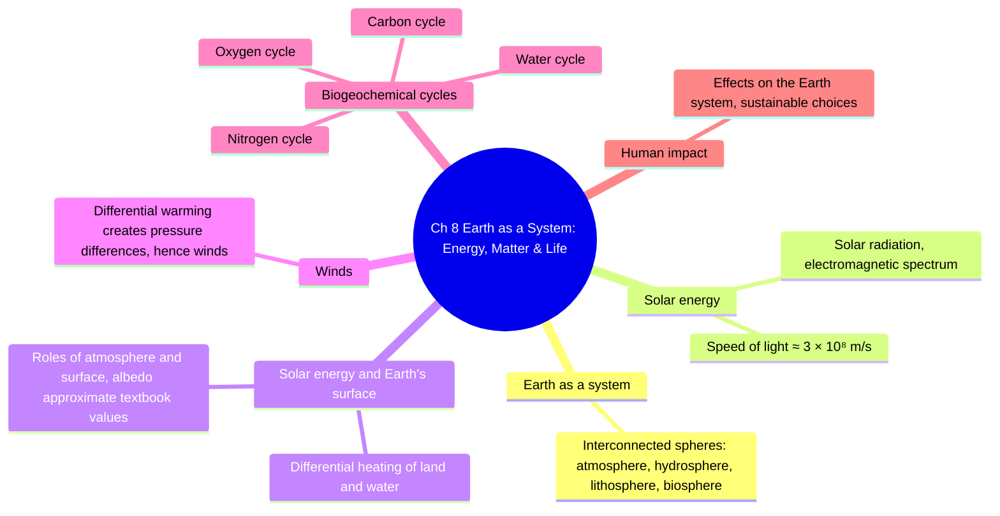

# Class IX · Ch 8 — Earth as a System: Energy, Matter & Life

*Earth as a system* · पृथ्वी के मंडल, सौर ऊर्जा, विभेदी तापन, पवन व जैव-भू-रासायनिक चक्र।

## Earth as a system

- Interconnected spheres: atmosphere, hydrosphere, lithosphere, biosphere

## Solar energy

- Solar radiation, electromagnetic spectrum
- Speed of light ≈ 3 × 10⁸ m/s

## Solar energy and Earth's surface

- Differential heating of land and water
- Roles of atmosphere and surface; albedo (approximate textbook values)

## Winds

- Differential warming creates pressure differences, hence winds

## Biogeochemical cycles

- Water cycle
- Carbon cycle
- Nitrogen cycle
- Oxygen cycle

## Human impact

- Effects on the Earth system; sustainable choices

## Learning outcomes

- Explain interconnections among biosphere, geosphere, hydrosphere, cryosphere, atmosphere
- Explain solar radiation as electromagnetic waves of different frequencies
- Explain differential heating by shape, latitude, tilt, absorption and reflection (albedo)
- Relate heating to air movement, evaporation, mountain/valley and sea/land breezes
- Explain the atmosphere’s role in weather and climate; identify reflectivity of materials from reliable sources
- Describe recycling of carbon, nitrogen, oxygen and water between biotic and abiotic environments
- Explain how cycles circulate matter and energy and maintain balance
- Reflect on changing conditions using traditional knowledge
- Draw flowcharts / concept maps; form hypotheses and predict outcomes
- Open question: what if Earth had no differential heating?

## Visual lessons in the app

- Earth’s five spheres
- Solar radiation & EM spectrum
- Differential heating of Earth
- Winds: sea, land, mountain, valley
- Water, carbon, nitrogen & oxygen cycles

## Review notes

- Albedo and spectrum values are approximate textbook figures.
