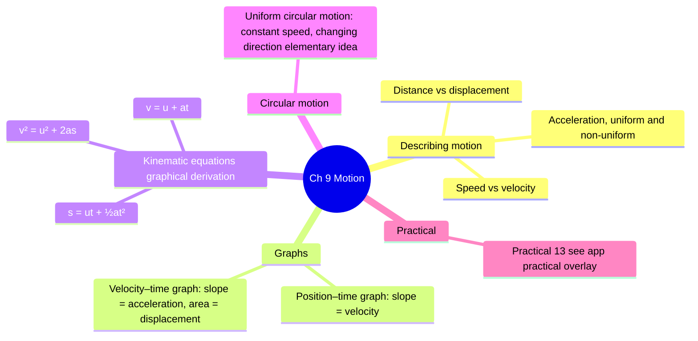

# Class IX · Ch 9 — Motion

*Motion, force, work & sound* · विस्थापन, वेग, त्वरण, ग्राफ़, गति के समीकरण और वृत्तीय गति।

## Describing motion

- Distance vs displacement
- Speed vs velocity
- Acceleration; uniform and non-uniform

## Graphs

- Position–time graph: slope = velocity
- Velocity–time graph: slope = acceleration; area = displacement

## Kinematic equations (graphical derivation)

- v = u + at
- s = ut + ½at²
- v² = u² + 2as

## Circular motion

- Uniform circular motion: constant speed, changing direction (elementary idea)

## Practical

- Practical 13 (see app practical overlay)

## Learning outcomes

- Differentiate distance/displacement; speed/velocity; use SI units
- Plot and interpret position–time and velocity–time graphs
- Average velocity from s–t; displacement and average acceleration from v–t
- Derive kinematic equations graphically; calculate unknown quantities
- Derive the expression for speed in uniform circular motion
- Analyse real-life motion, identify and control variables (practical 13)

## Practicals

- Practical 13

## Visual lessons in the app

- 1-D motion with live graphs
- Uniform circular motion
