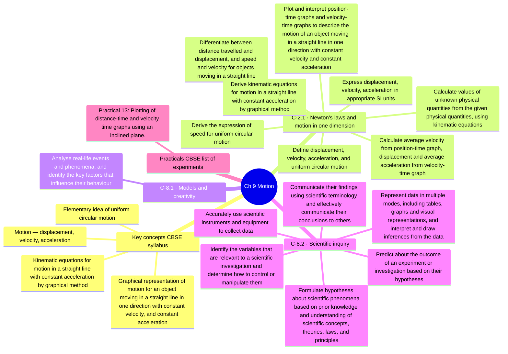

# Class IX · Ch 9 (CBSE ch 4, 13 periods) — Motion

*Motion, force, work & sound* · विस्थापन, वेग, त्वरण, ग्राफ़, गति के समीकरण और वृत्तीय गति।

## Key concepts (CBSE syllabus) _(CBSE key concept)_

- Motion — displacement, velocity, acceleration
- Graphical representation of motion for an object moving in a straight line in one direction (with constant velocity, and constant acceleration)
- Kinematic equations for motion in a straight line with constant acceleration (by graphical method)
- Elementary idea of uniform circular motion

## C-2.1 · Newton's laws and motion in one dimension _(CBSE learning outcomes)_

- Differentiate between distance travelled and displacement, and speed and velocity for objects moving in a straight line
- Define displacement, velocity, acceleration, and uniform circular motion
- Express displacement, velocity, acceleration in appropriate SI units
- Plot and interpret position-time graphs and velocity-time graphs to describe the motion of an object moving in a straight line in one direction (with constant velocity and constant acceleration)
- Calculate average velocity from position-time graph, displacement and average acceleration from velocity-time graph
- Derive kinematic equations for motion in a straight line with constant acceleration by graphical method
- Calculate values of unknown physical quantities from the given physical quantities, using kinematic equations
- Derive the expression of speed for uniform circular motion

## C-8.1 · Models and creativity _(CBSE learning outcomes)_

- Analyse real-life events and phenomena, and identify the key factors that influence their behaviour

## C-8.2 · Scientific inquiry _(CBSE learning outcomes)_

- Formulate hypotheses about scientific phenomena based on prior knowledge and understanding of scientific concepts, theories, laws, and principles
- Predict about the outcome of an experiment or investigation based on their hypotheses
- Identify the variables that are relevant to a scientific investigation and determine how to control or manipulate them
- Accurately use scientific instruments and equipment to collect data
- Represent data in multiple modes, including tables, graphs and visual representations, and interpret and draw inferences from the data
- Communicate their findings using scientific terminology and effectively communicate their conclusions to others

## Practicals (CBSE list of experiments) _(CBSE practical)_

- Practical 13: Plotting of distance-time and velocity time graphs using an inclined plane.

## Visual lessons in the app

- 1-D motion with live graphs
- Uniform circular motion
