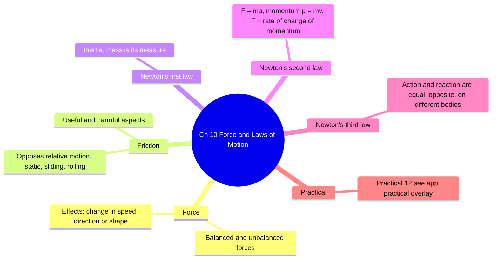

# Class IX · Ch 10 — Force and Laws of Motion

*Motion, force, work & sound* · संतुलित-असंतुलित बल, घर्षण और न्यूटन के तीन नियम।

## Force

- Balanced and unbalanced forces
- Effects: change in speed, direction or shape

## Friction

- Opposes relative motion; static, sliding, rolling
- Useful and harmful aspects

## Newton's first law

- Inertia; mass is its measure

## Newton's second law

- F = ma; momentum p = mv; F = rate of change of momentum

## Newton's third law

- Action and reaction are equal, opposite, on different bodies

## Practical

- Practical 12 (see app practical overlay)

## Learning outcomes

- Explain force as a vector
- Identify balanced and unbalanced situations; friction’s role
- Zero net force ⇒ constant velocity; net force ⇒ acceleration
- State and explain all three laws; F = ma; SI unit of force
- Apply the laws to everyday events
- Develop models, vary inputs and predict results (practical 12)

## Practicals

- Practical 12

## Visual lessons in the app

- Forces, friction & Newton’s laws
- Trolley, pulley & hanging mass
