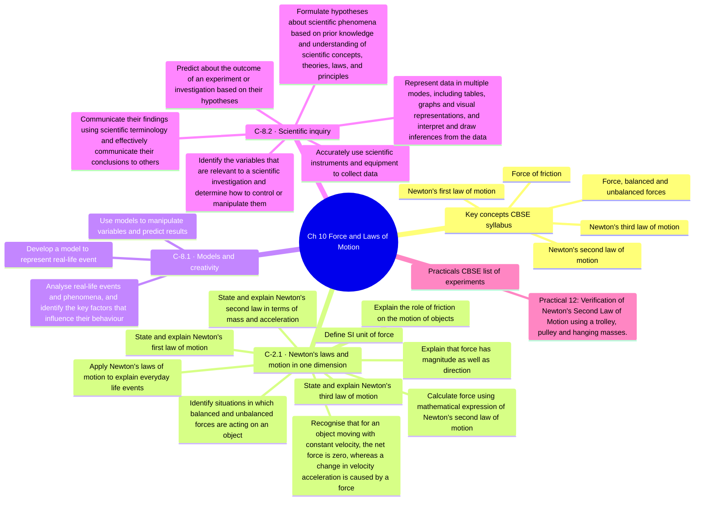

# Class IX · Ch 10 (CBSE ch 6, 13 periods) — Force and Laws of Motion

*Motion, force, work & sound* · संतुलित-असंतुलित बल, घर्षण और न्यूटन के तीन नियम।

## Key concepts (CBSE syllabus) _(CBSE key concept)_

- Force; balanced and unbalanced forces
- Force of friction
- Newton's first law of motion
- Newton's second law of motion
- Newton's third law of motion

## C-2.1 · Newton's laws and motion in one dimension _(CBSE learning outcomes)_

- Explain that force has magnitude as well as direction
- Identify situations in which balanced and unbalanced forces are acting on an object
- Explain the role of friction on the motion of objects
- Recognise that for an object moving with constant velocity, the net force is zero, whereas a change in velocity (acceleration) is caused by a force
- State and explain Newton's first law of motion
- State and explain Newton's second law in terms of mass and acceleration
- Calculate force using mathematical expression of Newton's second law of motion
- Define SI unit of force
- State and explain Newton's third law of motion
- Apply Newton's laws of motion to explain everyday life events

## C-8.1 · Models and creativity _(CBSE learning outcomes)_

- Analyse real-life events and phenomena, and identify the key factors that influence their behaviour
- Develop a model to represent real-life event
- Use models to manipulate variables and predict results

## C-8.2 · Scientific inquiry _(CBSE learning outcomes)_

- Formulate hypotheses about scientific phenomena based on prior knowledge and understanding of scientific concepts, theories, laws, and principles
- Predict about the outcome of an experiment or investigation based on their hypotheses
- Identify the variables that are relevant to a scientific investigation and determine how to control or manipulate them
- Accurately use scientific instruments and equipment to collect data
- Represent data in multiple modes, including tables, graphs and visual representations, and interpret and draw inferences from the data
- Communicate their findings using scientific terminology and effectively communicate their conclusions to others

## Practicals (CBSE list of experiments) _(CBSE practical)_

- Practical 12: Verification of Newton's Second Law of Motion using a trolley, pulley and hanging masses.

## Visual lessons in the app

- Forces, friction & Newton’s laws
- Trolley, pulley & hanging mass
