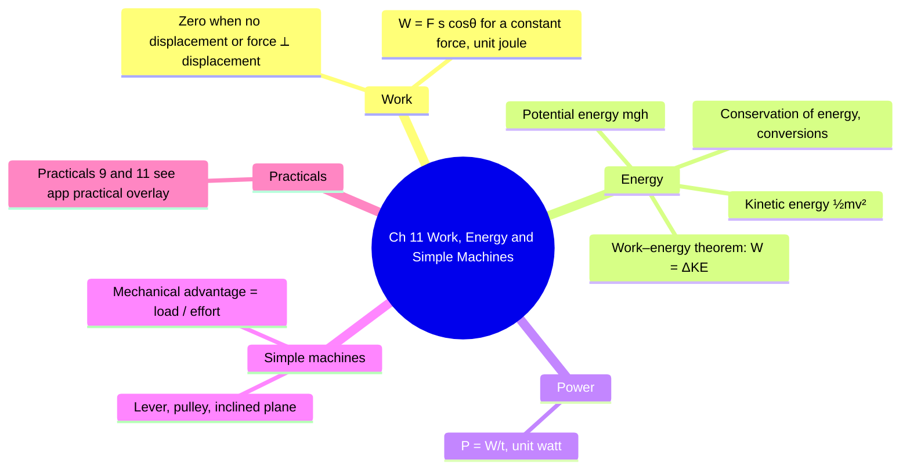

# Class IX · Ch 11 — Work, Energy and Simple Machines

*Motion, force, work & sound* · कार्य, ऊर्जा, ऊर्जा संरक्षण, शक्ति, लीवर, घिरनी, आनत तल।

## Work

- W = F s cosθ for a constant force; unit joule
- Zero when no displacement or force ⟂ displacement

## Energy

- Kinetic energy ½mv²
- Potential energy mgh
- Work–energy theorem: W = ΔKE
- Conservation of energy; conversions

## Power

- P = W/t; unit watt

## Simple machines

- Lever, pulley, inclined plane
- Mechanical advantage = load / effort

## Practicals

- Practicals 9 and 11 (see app practical overlay)

## Learning outcomes

- Define work and its SI unit; calculate work
- State the work–energy theorem; energy and its SI unit
- Forms of energy and everyday interconversions
- Derive and use kinetic and gravitational potential energy expressions
- PE–KE conversion in free fall; law of conservation of energy
- Define and calculate power
- Identify pulley, inclined plane and lever; define and calculate M.A. (practicals 9, 11)

## Practicals

- Practical 9
- Practical 11

## Visual lessons in the app

- Work, KE/PE, pendulum & power
- Lever, pulley & inclined plane
