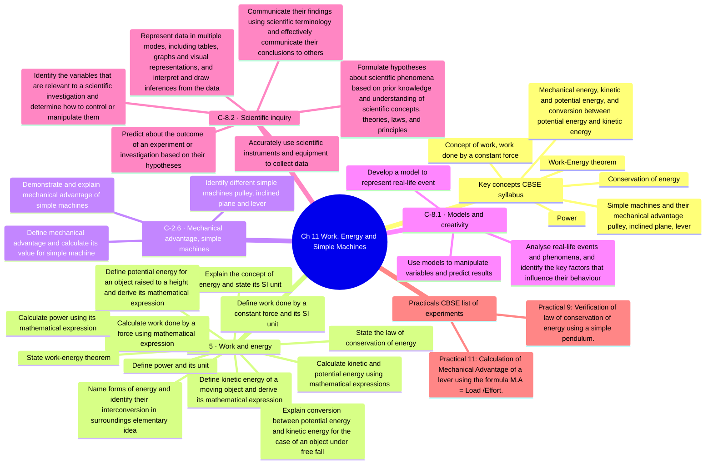

# Class IX · Ch 11 (CBSE ch 7, 13 periods) — Work, Energy and Simple Machines

*Motion, force, work & sound* · कार्य, ऊर्जा, ऊर्जा संरक्षण, शक्ति, लीवर, घिरनी, आनत तल।

## Key concepts (CBSE syllabus) _(CBSE key concept)_

- Concept of work; work done by a constant force
- Work-Energy theorem
- Mechanical energy, kinetic and potential energy, and conversion between potential energy and kinetic energy
- Conservation of energy
- Power
- Simple machines and their mechanical advantage (pulley, inclined plane, lever)

## C-2.5 · Work and energy _(CBSE learning outcomes)_

- Define work done by a constant force and its SI unit
- Calculate work done by a force using mathematical expression
- State work-energy theorem
- Explain the concept of energy and state its SI unit
- Name forms of energy and identify their interconversion in surroundings (elementary idea)
- Define kinetic energy of a moving object and derive its mathematical expression
- Define potential energy for an object raised to a height and derive its mathematical expression
- Calculate kinetic and potential energy using mathematical expressions
- Explain conversion between potential energy and kinetic energy (for the case of an object under free fall)
- State the law of conservation of energy
- Define power and its unit
- Calculate power using its mathematical expression

## C-2.6 · Mechanical advantage, simple machines _(CBSE learning outcomes)_

- Identify different simple machines (pulley, inclined plane and lever)
- Define mechanical advantage and calculate its value for simple machine
- Demonstrate and explain mechanical advantage of simple machines

## C-8.1 · Models and creativity _(CBSE learning outcomes)_

- Analyse real-life events and phenomena, and identify the key factors that influence their behaviour
- Develop a model to represent real-life event
- Use models to manipulate variables and predict results

## C-8.2 · Scientific inquiry _(CBSE learning outcomes)_

- Formulate hypotheses about scientific phenomena based on prior knowledge and understanding of scientific concepts, theories, laws, and principles
- Predict about the outcome of an experiment or investigation based on their hypotheses
- Identify the variables that are relevant to a scientific investigation and determine how to control or manipulate them
- Accurately use scientific instruments and equipment to collect data
- Represent data in multiple modes, including tables, graphs and visual representations, and interpret and draw inferences from the data
- Communicate their findings using scientific terminology and effectively communicate their conclusions to others

## Practicals (CBSE list of experiments) _(CBSE practical)_

- Practical 9: Verification of law of conservation of energy using a simple pendulum.
- Practical 11: Calculation of Mechanical Advantage of a lever using the formula M.A = Load /Effort.

## Visual lessons in the app

- Work, KE/PE, pendulum & power
- Lever, pulley & inclined plane
