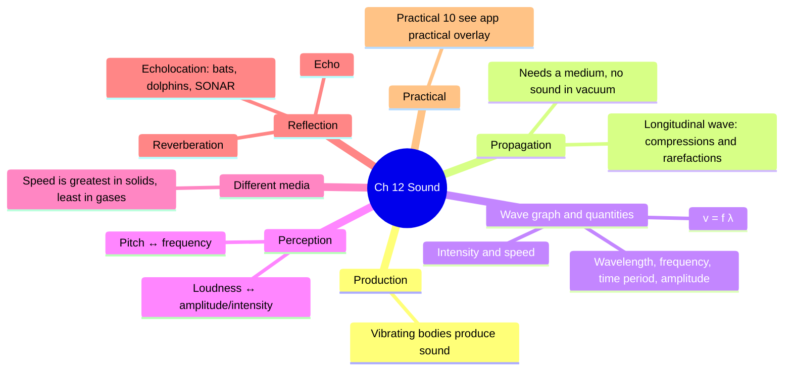

# Class IX · Ch 12 — Sound

*Motion, force, work & sound* · ध्वनि का उत्पादन व संचरण, तरंग गुण, प्रतिध्वनि व अनुरणन।

## Production

- Vibrating bodies produce sound

## Propagation

- Longitudinal wave: compressions and rarefactions
- Needs a medium; no sound in vacuum

## Wave graph and quantities

- Wavelength, frequency, time period, amplitude
- v = f λ
- Intensity and speed

## Perception

- Pitch ↔ frequency
- Loudness ↔ amplitude/intensity

## Different media

- Speed is greatest in solids, least in gases

## Reflection

- Echo
- Reverberation
- Echolocation: bats, dolphins, SONAR

## Practical

- Practical 10 (see app practical overlay)

## Learning outcomes

- Demonstrate sound production with strings, membranes and air columns
- Explain that sound needs a medium and travels as a longitudinal wave (air, solid, liquid)
- Describe and graph wavelength, frequency, period, amplitude, intensity, speed; analyse graphs
- Relate time period and frequency; derive and use the speed-of-sound expression
- Explain audible range, pitch and loudness
- Reflection, echo, reverberation, echolocation; music through loudness and pitch
- Gol Gumbaz whispering gallery; Sir C. V. Raman
- Develop models, vary factors and communicate conclusions (practical 10)

## Practicals

- Practical 10

## Visual lessons in the app

- Vibrating string, membrane & air column
- Longitudinal sound wave
- Echo, reverberation & echolocation
