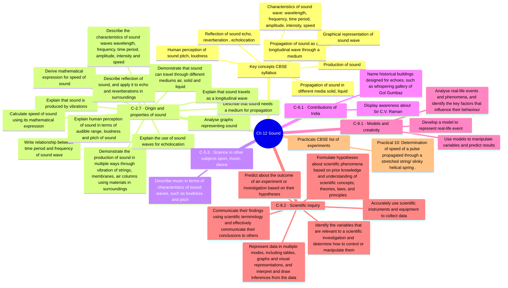

# Class IX · Ch 12 (CBSE ch 10, 11 periods) — Sound

*Motion, force, work & sound* · ध्वनि का उत्पादन व संचरण, तरंग गुण, प्रतिध्वनि व अनुरणन।

## Key concepts (CBSE syllabus) _(CBSE key concept)_

- Production of sound
- Propagation of sound (as a longitudinal wave through a medium)
- Graphical representation of sound wave
- Characteristics of sound wave: wavelength, frequency, time period, amplitude, intensity, speed
- Human perception of sound (pitch, loudness)
- Propagation of sound in different media (solid, liquid)
- Reflection of sound (echo, reverberation), echolocation

## C-2.7 · Origin and properties of sound _(CBSE learning outcomes)_

- Demonstrate the production of sound in multiple ways (through vibration of strings, membranes, air columns) using materials in surroundings
- Explain that sound is produced by vibrations
- Demonstrate that sound can travel through different mediums (air, solid and liquid)
- Describe that sound needs a medium for propagation
- Explain that sound travels as a longitudinal wave
- Describe the characteristics of sound waves (wavelength, frequency, time period, amplitude, intensity and speed)
- Analyse graphs representing sound
- Write relationship between time period and frequency of sound wave
- Derive mathematical expression for speed of sound
- Calculate speed of sound using its mathematical expression
- Explain human perception of sound in terms of audible range, loudness and pitch of sound
- Describe reflection of sound, and apply it to echo and reverberations in surroundings
- Explain the use of sound waves for echolocation

## C-5.3 · Science in other subjects (sport, music, dance) _(CBSE learning outcomes)_

- Describe music in terms of characteristics of sound waves, such as loudness and pitch

## C-6.1 · Contributions of India _(CBSE learning outcomes)_

- Name historical buildings designed for echoes, such as whispering gallery of Gol Gumbaz
- Display awareness about Sir C.V. Raman

## C-8.1 · Models and creativity _(CBSE learning outcomes)_

- Analyse real-life events and phenomena, and identify the key factors that influence their behaviour
- Develop a model to represent real-life event
- Use models to manipulate variables and predict results

## C-8.2 · Scientific inquiry _(CBSE learning outcomes)_

- Formulate hypotheses about scientific phenomena based on prior knowledge and understanding of scientific concepts, theories, laws, and principles
- Predict about the outcome of an experiment or investigation based on their hypotheses
- Identify the variables that are relevant to a scientific investigation and determine how to control or manipulate them
- Accurately use scientific instruments and equipment to collect data
- Represent data in multiple modes, including tables, graphs and visual representations, and interpret and draw inferences from the data
- Communicate their findings using scientific terminology and effectively communicate their conclusions to others

## Practicals (CBSE list of experiments) _(CBSE practical)_

- Practical 10: Determination of speed of a pulse propagated through a stretched string/ slinky (helical spring).

## Visual lessons in the app

- Vibrating string, membrane & air column
- Longitudinal sound wave
- Echo, reverberation & echolocation
