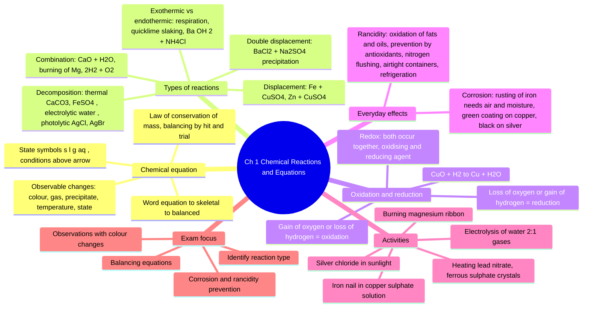

# Class X · Ch 1 — Chemical Reactions and Equations

*Chemistry* · रासायनिक अभिक्रियाएँ एवं समीकरण

## Chemical equation

- Word equation to skeletal to balanced
- Law of conservation of mass; balancing by hit and trial
- State symbols (s) (l) (g) (aq); conditions above arrow
- Observable changes: colour, gas, precipitate, temperature, state

## Types of reactions

- Combination: CaO + H2O, burning of Mg, 2H2 + O2
- Decomposition: thermal (CaCO3, FeSO4), electrolytic (water), photolytic (AgCl, AgBr)
- Displacement: Fe + CuSO4, Zn + CuSO4
- Double displacement: BaCl2 + Na2SO4 precipitation
- Exothermic vs endothermic: respiration, quicklime slaking, Ba(OH)2 + NH4Cl

## Oxidation and reduction

- Gain of oxygen or loss of hydrogen = oxidation
- Loss of oxygen or gain of hydrogen = reduction
- Redox: both occur together; oxidising and reducing agent
- CuO + H2 to Cu + H2O

## Everyday effects

- Corrosion: rusting of iron needs air and moisture; green coating on copper; black on silver
- Rancidity: oxidation of fats and oils; prevention by antioxidants, nitrogen flushing, airtight containers, refrigeration

## Activities

- Burning magnesium ribbon
- Iron nail in copper sulphate solution
- Heating lead nitrate; ferrous sulphate crystals
- Electrolysis of water 2:1 gases
- Silver chloride in sunlight

## Exam focus

- Balancing equations
- Identify reaction type
- Observations with colour changes
- Corrosion and rancidity prevention

## Visual lessons in the app

- Iron nail in copper sulphate
- Balancing a chemical equation
- Combination & decomposition
- Oxidation and reduction
- Corrosion and rancidity
