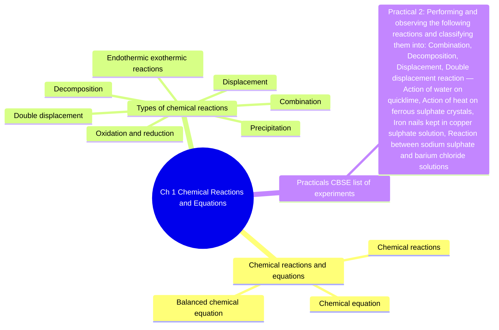

# Class X · Ch 1 — Chemical Reactions and Equations

*Unit I · Chemical Substances – Nature and Behaviour (25 marks)* · रासायनिक अभिक्रियाएँ एवं समीकरण

## Chemical reactions and equations _(CBSE key concept)_

- Chemical reactions
- Chemical equation
- Balanced chemical equation

## Types of chemical reactions _(CBSE key concept)_

- Combination
- Decomposition
- Displacement
- Double displacement
- Precipitation
- Endothermic exothermic reactions
- Oxidation and reduction

## Practicals (CBSE list of experiments) _(CBSE practical)_

- Practical 2: Performing and observing the following reactions and classifying them into: Combination, Decomposition, Displacement, Double displacement reaction — Action of water on quicklime; Action of heat on ferrous sulphate crystals; Iron nails kept in copper sulphate solution; Reaction between sodium sulphate and barium chloride solutions

## Visual lessons in the app

- Iron nail in copper sulphate
- Balancing a chemical equation
- Combination & decomposition
- Oxidation and reduction
- Corrosion and rancidity
