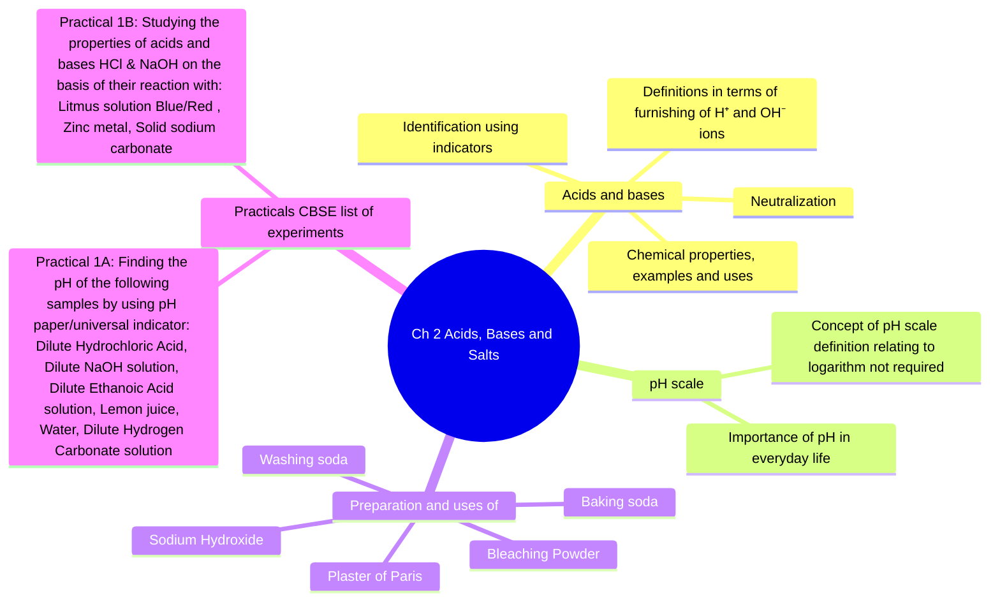

# Class X · Ch 2 — Acids, Bases and Salts

*Unit I · Chemical Substances – Nature and Behaviour (25 marks)* · अम्ल, क्षार तथा लवण

## Acids and bases _(CBSE key concept)_

- Definitions in terms of furnishing of H⁺ and OH⁻ ions
- Identification using indicators
- Chemical properties, examples and uses
- Neutralization

## pH scale _(CBSE key concept)_

- Concept of pH scale (definition relating to logarithm not required)
- Importance of pH in everyday life

## Preparation and uses of _(CBSE key concept)_

- Sodium Hydroxide
- Bleaching Powder
- Baking soda
- Washing soda
- Plaster of Paris

## Practicals (CBSE list of experiments) _(CBSE practical)_

- Practical 1A: Finding the pH of the following samples by using pH paper/universal indicator: Dilute Hydrochloric Acid; Dilute NaOH solution; Dilute Ethanoic Acid solution; Lemon juice; Water; Dilute Hydrogen Carbonate solution
- Practical 1B: Studying the properties of acids and bases (HCl & NaOH) on the basis of their reaction with: Litmus solution (Blue/Red); Zinc metal; Solid sodium carbonate

## Visual lessons in the app

- pH scale & universal indicator
- Acids & bases with metals, carbonates, oxides
- Indicators (litmus, turmeric)
- Neutralisation
- Important salts
- pH in everyday life
- Chemicals from salt: NaOH, bleaching powder, soda, PoP
