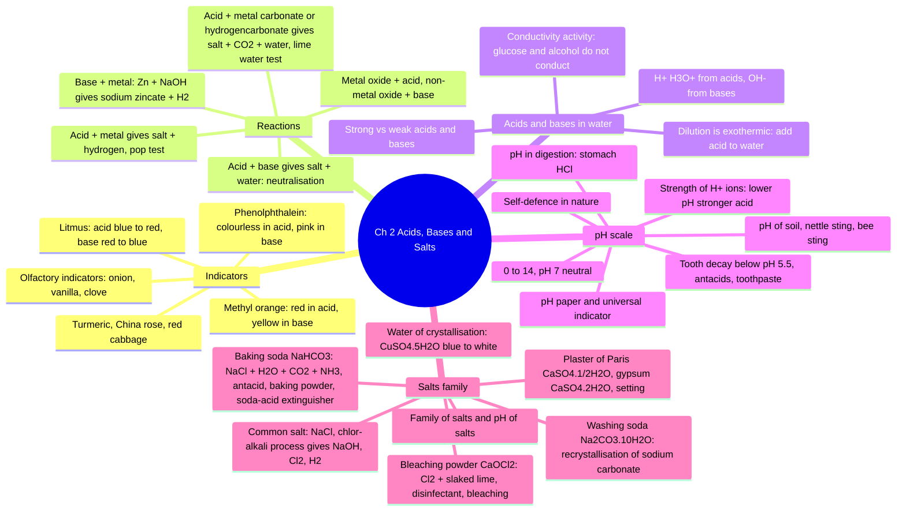

# Class X · Ch 2 — Acids, Bases and Salts

*Chemistry* · अम्ल, क्षार तथा लवण

## Indicators

- Litmus: acid blue to red, base red to blue
- Phenolphthalein: colourless in acid, pink in base
- Methyl orange: red in acid, yellow in base
- Olfactory indicators: onion, vanilla, clove
- Turmeric, China rose, red cabbage

## Reactions

- Acid + metal gives salt + hydrogen; pop test
- Acid + metal carbonate or hydrogencarbonate gives salt + CO2 + water; lime water test
- Acid + base gives salt + water: neutralisation
- Metal oxide + acid; non-metal oxide + base
- Base + metal: Zn + NaOH gives sodium zincate + H2

## Acids and bases in water

- H+ (H3O+) from acids; OH- from bases
- Dilution is exothermic: add acid to water
- Strong vs weak acids and bases
- Conductivity activity: glucose and alcohol do not conduct

## pH scale

- 0 to 14; pH 7 neutral
- pH paper and universal indicator
- Strength of H+ ions: lower pH stronger acid
- pH in digestion: stomach HCl
- Tooth decay below pH 5.5; antacids; toothpaste
- pH of soil; nettle sting; bee sting
- Self-defence in nature

## Salts family

- Family of salts and pH of salts
- Common salt: NaCl; chlor-alkali process gives NaOH, Cl2, H2
- Bleaching powder CaOCl2: Cl2 + slaked lime; disinfectant, bleaching
- Baking soda NaHCO3: NaCl + H2O + CO2 + NH3; antacid, baking powder, soda-acid extinguisher
- Washing soda Na2CO3.10H2O: recrystallisation of sodium carbonate
- Plaster of Paris CaSO4.1/2H2O; gypsum CaSO4.2H2O; setting
- Water of crystallisation: CuSO4.5H2O blue to white

## Visual lessons in the app

- pH scale & universal indicator
- Acids & bases with metals, carbonates, oxides
- Indicators (litmus, turmeric)
- Neutralisation
- Important salts
