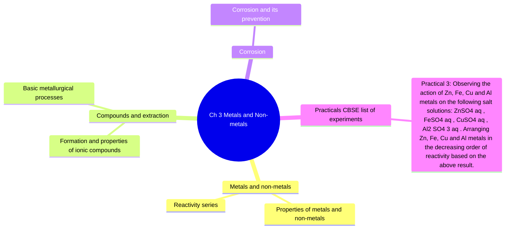

# Class X · Ch 3 — Metals and Non-metals

*Unit I · Chemical Substances – Nature and Behaviour (25 marks)* · धातु एवं अधातु

## Metals and non-metals _(CBSE key concept)_

- Properties of metals and non-metals
- Reactivity series

## Compounds and extraction _(CBSE key concept)_

- Formation and properties of ionic compounds
- Basic metallurgical processes

## Corrosion _(CBSE key concept)_

- Corrosion and its prevention

## Practicals (CBSE list of experiments) _(CBSE practical)_

- Practical 3: Observing the action of Zn, Fe, Cu and Al metals on the following salt solutions: ZnSO4 (aq), FeSO4 (aq), CuSO4 (aq), Al2(SO4)3 (aq). Arranging Zn, Fe, Cu and Al (metals) in the decreasing order of reactivity based on the above result.

## Visual lessons in the app

- Physical properties: metals vs non-metals
- Ionic bond: forming NaCl
- Reactivity series
- Extraction of metals
- Preventing corrosion
