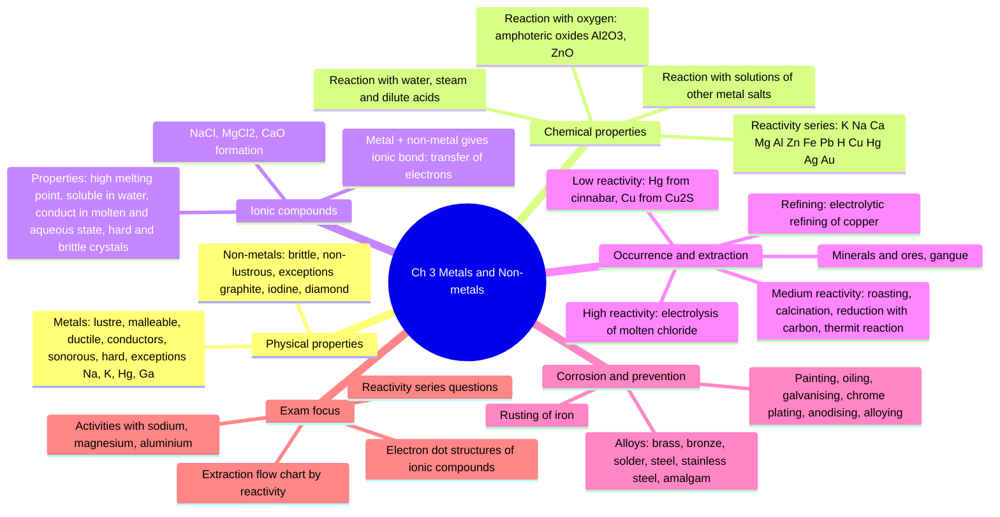

# Class X · Ch 3 — Metals and Non-metals

*Chemistry* · धातु एवं अधातु

## Physical properties

- Metals: lustre, malleable, ductile, conductors, sonorous, hard; exceptions Na, K, Hg, Ga
- Non-metals: brittle, non-lustrous; exceptions graphite, iodine, diamond

## Chemical properties

- Reaction with oxygen: amphoteric oxides Al2O3, ZnO
- Reaction with water, steam and dilute acids
- Reaction with solutions of other metal salts
- Reactivity series: K Na Ca Mg Al Zn Fe Pb H Cu Hg Ag Au

## Ionic compounds

- Metal + non-metal gives ionic bond: transfer of electrons
- NaCl, MgCl2, CaO formation
- Properties: high melting point, soluble in water, conduct in molten and aqueous state, hard and brittle crystals

## Occurrence and extraction

- Minerals and ores; gangue
- Low reactivity: Hg from cinnabar; Cu from Cu2S
- Medium reactivity: roasting, calcination, reduction with carbon; thermit reaction
- High reactivity: electrolysis of molten chloride
- Refining: electrolytic refining of copper

## Corrosion and prevention

- Rusting of iron
- Painting, oiling, galvanising, chrome plating, anodising, alloying
- Alloys: brass, bronze, solder, steel, stainless steel, amalgam

## Exam focus

- Reactivity series questions
- Electron dot structures of ionic compounds
- Extraction flow chart by reactivity
- Activities with sodium, magnesium, aluminium

## Visual lessons in the app

- Physical properties: metals vs non-metals
- Ionic bond: forming NaCl
- Reactivity series
- Extraction of metals
- Preventing corrosion
