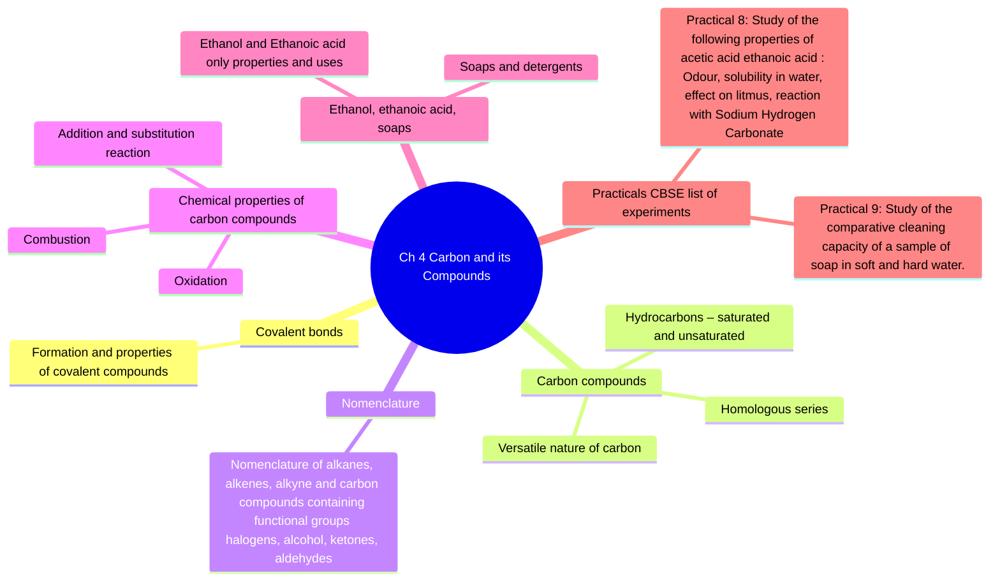

# Class X · Ch 4 — Carbon and its Compounds

*Unit I · Chemical Substances – Nature and Behaviour (25 marks)* · कार्बन एवं उसके यौगिक

## Covalent bonds _(CBSE key concept)_

- Formation and properties of covalent compounds

## Carbon compounds _(CBSE key concept)_

- Versatile nature of carbon
- Hydrocarbons – saturated and unsaturated
- Homologous series

## Nomenclature _(CBSE key concept)_

- Nomenclature of alkanes, alkenes, alkyne and carbon compounds containing functional groups (halogens, alcohol, ketones, aldehydes)

## Chemical properties of carbon compounds _(CBSE key concept)_

- Combustion
- Oxidation
- Addition and substitution reaction

## Ethanol, ethanoic acid, soaps _(CBSE key concept)_

- Ethanol and Ethanoic acid (only properties and uses)
- Soaps and detergents

## Practicals (CBSE list of experiments) _(CBSE practical)_

- Practical 8: Study of the following properties of acetic acid (ethanoic acid): Odour; solubility in water; effect on litmus; reaction with Sodium Hydrogen Carbonate
- Practical 9: Study of the comparative cleaning capacity of a sample of soap in soft and hard water.

## Visual lessons in the app

- Covalent bonding: sharing electrons
- Allotropes of carbon
- Homologous series & nomenclature
- Hydrocarbons & functional groups (3D)
- Ethanol & ethanoic acid
- Soap micelle
- Combustion, addition, substitution
