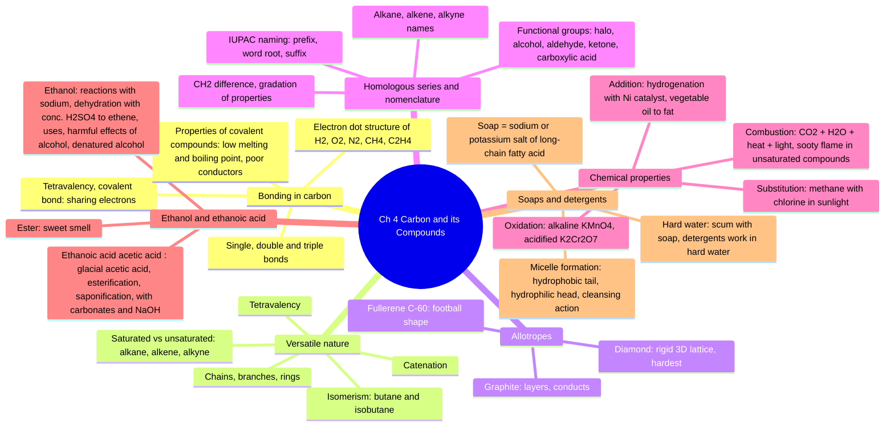

# Class X · Ch 4 — Carbon and its Compounds

*Chemistry* · कार्बन एवं उसके यौगिक

## Bonding in carbon

- Tetravalency; covalent bond: sharing electrons
- Single, double and triple bonds
- Electron dot structure of H2, O2, N2, CH4, C2H4
- Properties of covalent compounds: low melting and boiling point, poor conductors

## Versatile nature

- Catenation
- Tetravalency
- Chains, branches, rings
- Saturated vs unsaturated: alkane, alkene, alkyne
- Isomerism: butane and isobutane

## Allotropes

- Diamond: rigid 3D lattice, hardest
- Graphite: layers, conducts
- Fullerene C-60: football shape

## Homologous series and nomenclature

- CH2 difference; gradation of properties
- Functional groups: halo, alcohol, aldehyde, ketone, carboxylic acid
- IUPAC naming: prefix, word root, suffix
- Alkane, alkene, alkyne names

## Chemical properties

- Combustion: CO2 + H2O + heat + light; sooty flame in unsaturated compounds
- Oxidation: alkaline KMnO4, acidified K2Cr2O7
- Addition: hydrogenation with Ni catalyst; vegetable oil to fat
- Substitution: methane with chlorine in sunlight

## Ethanol and ethanoic acid

- Ethanol: reactions with sodium; dehydration with conc. H2SO4 to ethene; uses; harmful effects of alcohol; denatured alcohol
- Ethanoic acid (acetic acid): glacial acetic acid; esterification, saponification; with carbonates and NaOH
- Ester: sweet smell

## Soaps and detergents

- Soap = sodium or potassium salt of long-chain fatty acid
- Micelle formation: hydrophobic tail, hydrophilic head; cleansing action
- Hard water: scum with soap; detergents work in hard water

## Visual lessons in the app

- Covalent bonding: sharing electrons
- Allotropes of carbon
- Homologous series & nomenclature
- Hydrocarbons & functional groups (3D)
- Ethanol & ethanoic acid
- Soap micelle
- Combustion, addition, substitution
