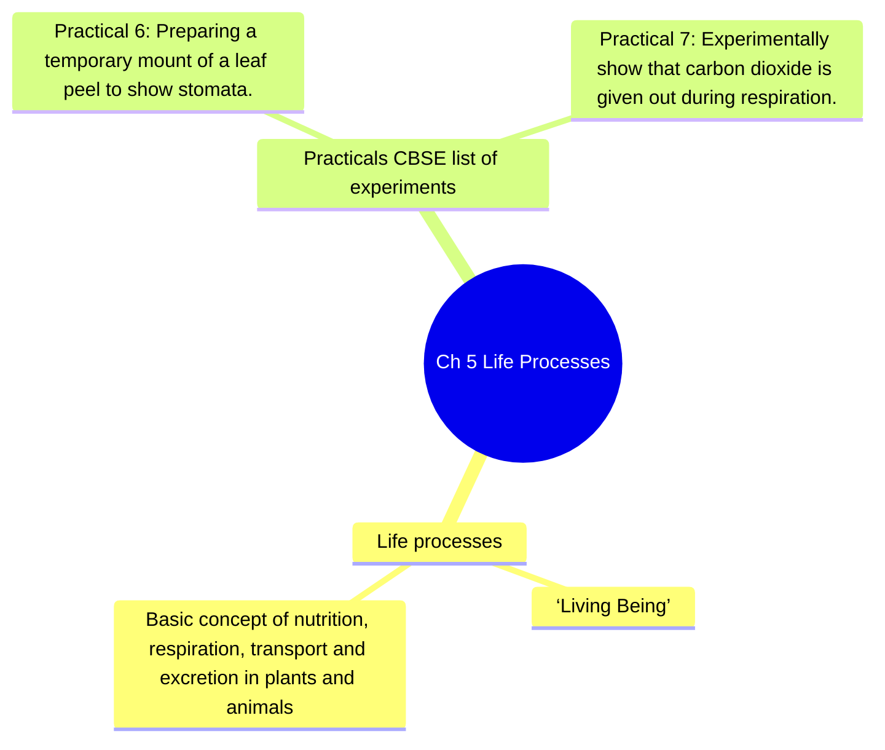

# Class X · Ch 5 — Life Processes

*Unit II · World of Living (25 marks)* · जैव प्रक्रम

## Life processes _(CBSE key concept)_

- ‘Living Being’
- Basic concept of nutrition, respiration, transport and excretion in plants and animals

## Practicals (CBSE list of experiments) _(CBSE practical)_

- Practical 6: Preparing a temporary mount of a leaf peel to show stomata.
- Practical 7: Experimentally show that carbon dioxide is given out during respiration.

## Visual lessons in the app

- Heart & double circulation
- Human digestive system
- Breathing & alveoli
- Nephron & urine formation
- Transport in plants
