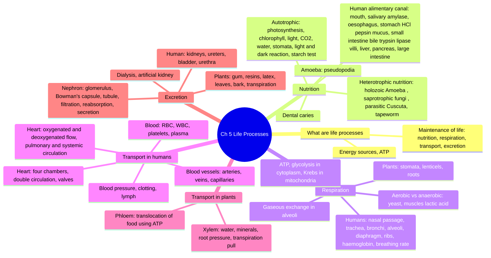

# Class X · Ch 5 — Life Processes

*Biology* · जैव प्रक्रम

## What are life processes

- Maintenance of life: nutrition, respiration, transport, excretion
- Energy sources; ATP

## Nutrition

- Autotrophic: photosynthesis; chlorophyll, light, CO2, water; stomata; light and dark reaction; starch test
- Heterotrophic nutrition: holozoic (Amoeba), saprotrophic (fungi), parasitic (Cuscuta, tapeworm)
- Amoeba: pseudopodia
- Human alimentary canal: mouth, salivary amylase, oesophagus, stomach HCl pepsin mucus, small intestine bile trypsin lipase villi, liver, pancreas, large intestine
- Dental caries

## Respiration

- Aerobic vs anaerobic: yeast, muscles lactic acid
- ATP; glycolysis in cytoplasm; Krebs in mitochondria
- Plants: stomata; lenticels; roots
- Humans: nasal passage, trachea, bronchi, alveoli, diaphragm, ribs; haemoglobin; breathing rate
- Gaseous exchange in alveoli

## Transport in humans

- Heart: four chambers; double circulation; valves
- Blood: RBC, WBC, platelets, plasma
- Blood vessels: arteries, veins, capillaries
- Blood pressure; clotting; lymph
- Heart: oxygenated and deoxygenated flow; pulmonary and systemic circulation

## Transport in plants

- Xylem: water, minerals; root pressure, transpiration pull
- Phloem: translocation of food using ATP

## Excretion

- Human: kidneys, ureters, bladder, urethra
- Nephron: glomerulus, Bowman's capsule, tubule; filtration, reabsorption, secretion
- Dialysis; artificial kidney
- Plants: gum, resins, latex, leaves, bark; transpiration

## Visual lessons in the app

- Heart & double circulation
- Human digestive system
- Breathing & alveoli
- Nephron & urine formation
- Transport in plants
