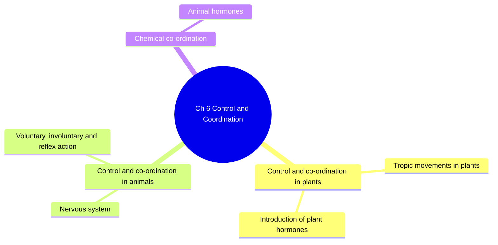

# Class X · Ch 6 — Control and Coordination

*Unit II · World of Living (25 marks)* · नियंत्रण एवं समन्वय

## Control and co-ordination in plants _(CBSE key concept)_

- Tropic movements in plants
- Introduction of plant hormones

## Control and co-ordination in animals _(CBSE key concept)_

- Nervous system
- Voluntary, involuntary and reflex action

## Chemical co-ordination _(CBSE key concept)_

- Animal hormones

## Visual lessons in the app

- Reflex arc
- Neuron & nerve impulse
- Synapse
- Human brain
- Plant movements & auxin
- Endocrine glands & hormones
