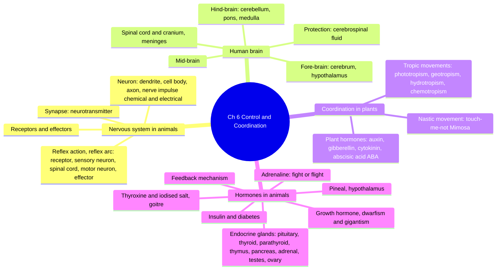

# Class X · Ch 6 — Control and Coordination

*Biology* · नियंत्रण एवं समन्वय

## Nervous system in animals

- Receptors and effectors
- Neuron: dendrite, cell body, axon; nerve impulse chemical and electrical
- Synapse: neurotransmitter
- Reflex action; reflex arc: receptor, sensory neuron, spinal cord, motor neuron, effector

## Human brain

- Fore-brain: cerebrum, hypothalamus
- Mid-brain
- Hind-brain: cerebellum, pons, medulla
- Spinal cord and cranium; meninges
- Protection: cerebrospinal fluid

## Coordination in plants

- Tropic movements: phototropism, geotropism, hydrotropism, chemotropism
- Nastic movement: touch-me-not (Mimosa)
- Plant hormones: auxin, gibberellin, cytokinin, abscisic acid (ABA)

## Hormones in animals

- Endocrine glands: pituitary, thyroid, parathyroid, thymus, pancreas, adrenal, testes, ovary
- Thyroxine and iodised salt; goitre
- Growth hormone; dwarfism and gigantism
- Insulin and diabetes
- Adrenaline: fight or flight
- Feedback mechanism
- Pineal; hypothalamus

## Visual lessons in the app

- Reflex arc
- Neuron & nerve impulse
- Synapse
- Human brain
- Plant movements & auxin
- Endocrine glands & hormones
