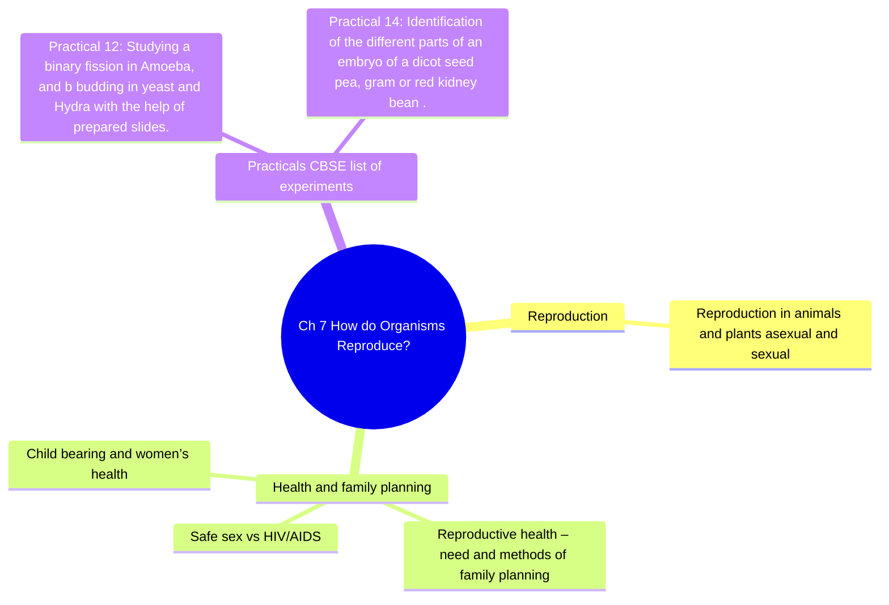

# Class X · Ch 7 — How do Organisms Reproduce?

*Unit II · World of Living (25 marks)* · जीव जनन कैसे करते हैं

## Reproduction _(CBSE key concept)_

- Reproduction in animals and plants (asexual and sexual)

## Health and family planning _(CBSE key concept)_

- Reproductive health – need and methods of family planning
- Safe sex vs HIV/AIDS
- Child bearing and women’s health

## Practicals (CBSE list of experiments) _(CBSE practical)_

- Practical 12: Studying (a) binary fission in Amoeba, and (b) budding in yeast and Hydra with the help of prepared slides.
- Practical 14: Identification of the different parts of an embryo of a dicot seed (pea, gram or red kidney bean).

## Visual lessons in the app

- Human reproduction: fertilisation to placenta
- Binary fission in Amoeba
- Budding in Hydra
- Vegetative propagation
- Flower & fertilisation
- Spore formation in bread mould
- Dicot seed: embryo parts
- Family planning, HIV/AIDS & women’s health
