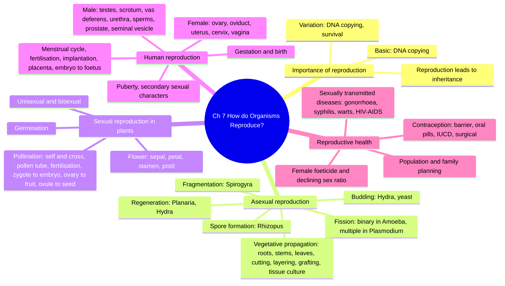

# Class X · Ch 7 — How do Organisms Reproduce?

*Biology* · जीव जनन कैसे करते हैं

## Importance of reproduction

- Variation: DNA copying; survival
- Basic: DNA copying
- Reproduction leads to inheritance

## Asexual reproduction

- Fission: binary in Amoeba, multiple in Plasmodium
- Fragmentation: Spirogyra
- Regeneration: Planaria, Hydra
- Budding: Hydra, yeast
- Vegetative propagation: roots, stems, leaves; cutting, layering, grafting; tissue culture
- Spore formation: Rhizopus

## Sexual reproduction in plants

- Flower: sepal, petal, stamen, pistil
- Unisexual and bisexual
- Pollination: self and cross; pollen tube, fertilisation; zygote to embryo; ovary to fruit; ovule to seed
- Germination

## Human reproduction

- Puberty; secondary sexual characters
- Male: testes, scrotum, vas deferens, urethra, sperms, prostate, seminal vesicle
- Female: ovary, oviduct, uterus, cervix, vagina
- Menstrual cycle; fertilisation; implantation; placenta; embryo to foetus
- Gestation and birth

## Reproductive health

- Contraception: barrier, oral pills, IUCD, surgical
- Sexually transmitted diseases: gonorrhoea, syphilis, warts, HIV-AIDS
- Female foeticide and declining sex ratio
- Population and family planning

## Visual lessons in the app

- Human reproduction: fertilisation to placenta
- Binary fission in Amoeba
- Budding in Hydra
- Vegetative propagation
- Flower & fertilisation
