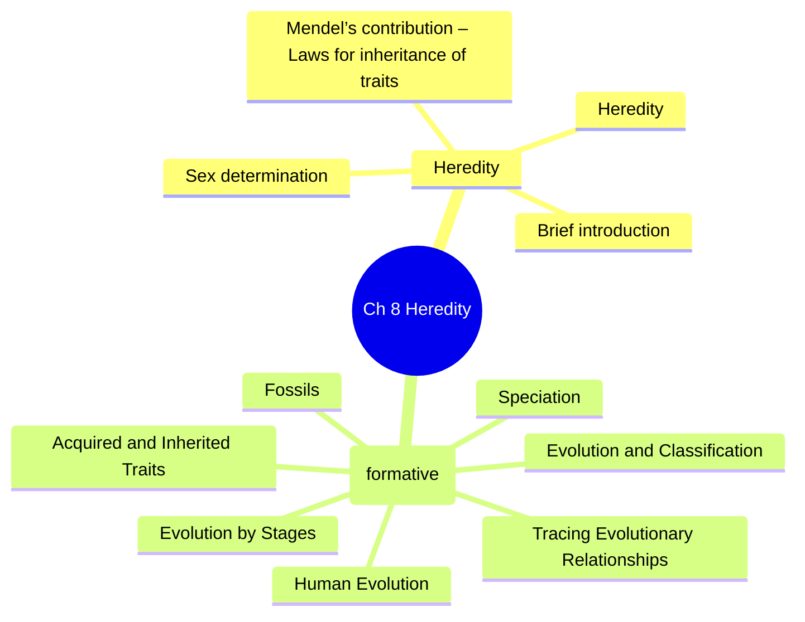

# Class X · Ch 8 — Heredity

*Unit II · World of Living (25 marks)* · आनुवंशिकता

## Heredity _(CBSE key concept)_

- Heredity
- Mendel’s contribution – Laws for inheritance of traits
- Sex determination
- Brief introduction

## Evolution _(formative-only in 2026–27; not in year-end exam)_

- Acquired and Inherited Traits
- Speciation
- Evolution and Classification
- Tracing Evolutionary Relationships
- Fossils
- Evolution by Stages
- Human Evolution

## Visual lessons in the app

- Mendel's monohybrid cross
- Independent inheritance (dihybrid)
- Sex determination
- Evolution (Reading Material)
- Accumulation of variation
- Acquired vs inherited traits; selection & drift
- Speciation
- Fossils & dating
- Evolution by stages & human evolution
