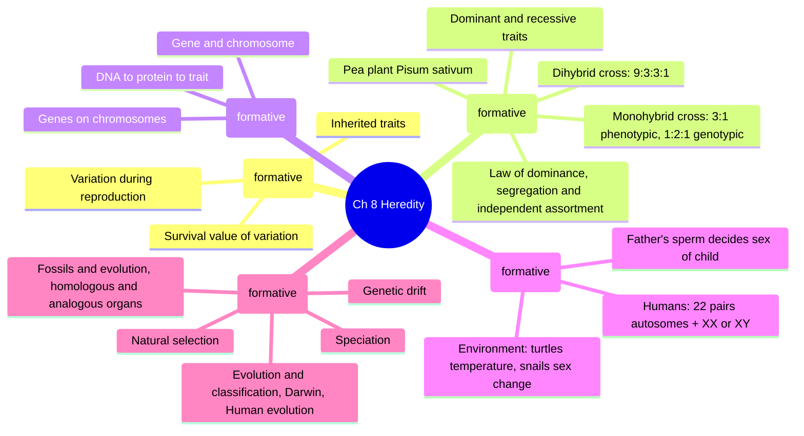

# Class X · Ch 8 — Heredity

*Biology* · आनुवंशिकता

## Accumulation of variation _(formative-only in 2026–27; not in year-end exam)_

- Variation during reproduction
- Inherited traits
- Survival value of variation

## Mendel's contributions _(formative-only in 2026–27; not in year-end exam)_

- Pea plant Pisum sativum
- Monohybrid cross: 3:1 phenotypic, 1:2:1 genotypic
- Dihybrid cross: 9:3:3:1
- Dominant and recessive traits
- Law of dominance, segregation and independent assortment

## How traits are expressed _(formative-only in 2026–27; not in year-end exam)_

- DNA to protein to trait
- Genes on chromosomes
- Gene and chromosome

## Sex determination _(formative-only in 2026–27; not in year-end exam)_

- Humans: 22 pairs autosomes + XX or XY
- Father's sperm decides sex of child
- Environment: turtles temperature; snails sex change

## Evolution (reading material) _(formative-only in 2026–27; not in year-end exam)_

- Speciation
- Natural selection
- Genetic drift
- Fossils and evolution; homologous and analogous organs
- Evolution and classification; Darwin; Human evolution

## Visual lessons in the app

- Mendel's monohybrid cross
- Independent inheritance (dihybrid)
- Sex determination
- Evolution (Reading Material)
