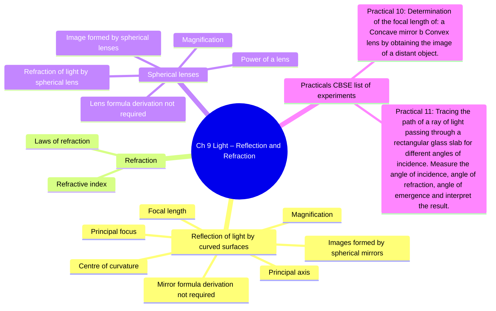

# Class X · Ch 9 — Light – Reflection and Refraction

*Unit III · Natural Phenomena (12 marks)* · प्रकाश – परावर्तन तथा अपवर्तन

## Reflection of light by curved surfaces _(CBSE key concept)_

- Images formed by spherical mirrors
- Centre of curvature
- Principal axis
- Principal focus
- Focal length
- Mirror formula (derivation not required)
- Magnification

## Refraction _(CBSE key concept)_

- Laws of refraction
- Refractive index

## Spherical lenses _(CBSE key concept)_

- Refraction of light by spherical lens
- Image formed by spherical lenses
- Lens formula (derivation not required)
- Magnification
- Power of a lens

## Practicals (CBSE list of experiments) _(CBSE practical)_

- Practical 10: Determination of the focal length of: (a) Concave mirror (b) Convex lens by obtaining the image of a distant object.
- Practical 11: Tracing the path of a ray of light passing through a rectangular glass slab for different angles of incidence. Measure the angle of incidence, angle of refraction, angle of emergence and interpret the result.

## Visual lessons in the app

- Laws of reflection (plane mirror)
- Image formation: mirrors & lenses
- Refraction through a glass slab
- Power of a lens
