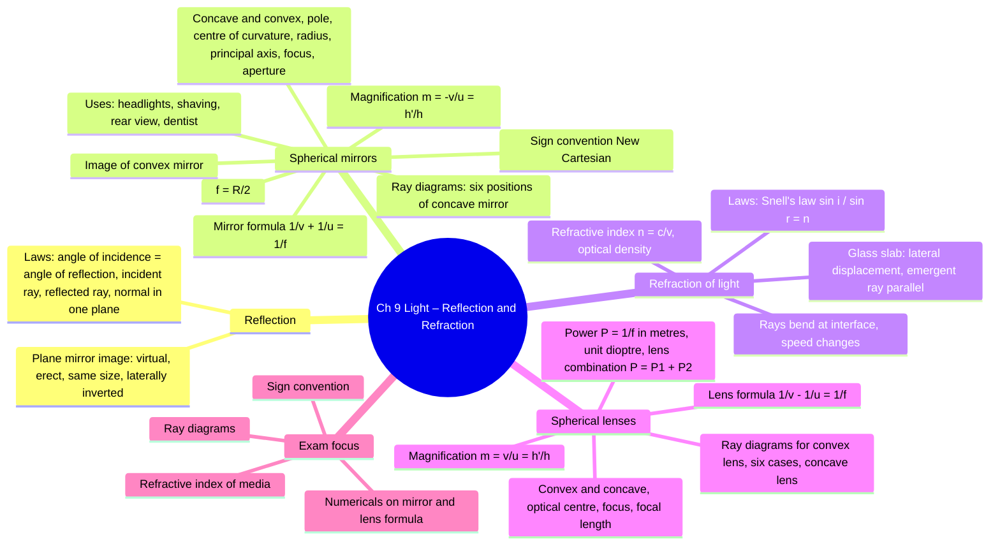

# Class X · Ch 9 — Light – Reflection and Refraction

*Physics* · प्रकाश – परावर्तन तथा अपवर्तन

## Reflection

- Laws: angle of incidence = angle of reflection; incident ray, reflected ray, normal in one plane
- Plane mirror image: virtual, erect, same size, laterally inverted

## Spherical mirrors

- Concave and convex; pole, centre of curvature, radius, principal axis, focus, aperture
- f = R/2
- Ray diagrams: six positions of concave mirror
- Image of convex mirror
- Sign convention (New Cartesian)
- Mirror formula 1/v + 1/u = 1/f
- Magnification m = -v/u = h'/h
- Uses: headlights, shaving, rear view, dentist

## Refraction of light

- Rays bend at interface; speed changes
- Laws: Snell's law sin i / sin r = n
- Refractive index n = c/v; optical density
- Glass slab: lateral displacement, emergent ray parallel

## Spherical lenses

- Convex and concave; optical centre, focus, focal length
- Ray diagrams for convex lens, six cases; concave lens
- Lens formula 1/v - 1/u = 1/f
- Magnification m = v/u = h'/h
- Power P = 1/f in metres; unit dioptre; lens combination P = P1 + P2

## Exam focus

- Numericals on mirror and lens formula
- Ray diagrams
- Sign convention
- Refractive index of media

## Visual lessons in the app

- Laws of reflection (plane mirror)
- Image formation: mirrors & lenses
- Refraction through a glass slab
- Power of a lens
