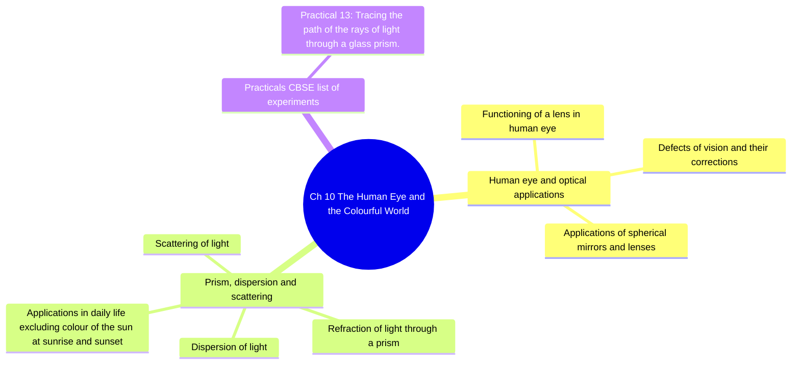

# Class X · Ch 10 — The Human Eye and the Colourful World

*Unit III · Natural Phenomena (12 marks)* · मानव नेत्र एवं रंग-बिरंगा संसार

## Human eye and optical applications _(CBSE key concept)_

- Functioning of a lens in human eye
- Defects of vision and their corrections
- Applications of spherical mirrors and lenses

## Prism, dispersion and scattering _(CBSE key concept)_

- Refraction of light through a prism
- Dispersion of light
- Scattering of light
- Applications in daily life (excluding colour of the sun at sunrise and sunset)

## Practicals (CBSE list of experiments) _(CBSE practical)_

- Practical 13: Tracing the path of the rays of light through a glass prism.

## Visual lessons in the app

- Structure of the human eye
- Accommodation & defects of vision
- Dispersion by a prism
- Scattering of light (blue sky)
