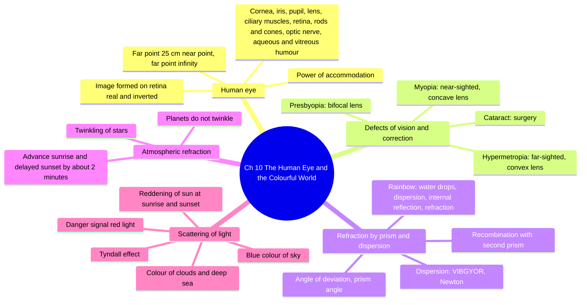

# Class X · Ch 10 — The Human Eye and the Colourful World

*Physics* · मानव नेत्र एवं रंग-बिरंगा संसार

## Human eye

- Cornea, iris, pupil, lens, ciliary muscles, retina, rods and cones, optic nerve, aqueous and vitreous humour
- Image formed on retina real and inverted
- Power of accommodation
- Far point 25 cm near point; far point infinity

## Defects of vision and correction

- Myopia: near-sighted; concave lens
- Hypermetropia: far-sighted; convex lens
- Presbyopia: bifocal lens
- Cataract: surgery

## Refraction by prism and dispersion

- Angle of deviation; prism angle
- Dispersion: VIBGYOR; Newton
- Rainbow: water drops, dispersion, internal reflection, refraction
- Recombination with second prism

## Atmospheric refraction

- Twinkling of stars
- Advance sunrise and delayed sunset by about 2 minutes
- Planets do not twinkle

## Scattering of light

- Tyndall effect
- Blue colour of sky
- Reddening of sun at sunrise and sunset
- Danger signal red light
- Colour of clouds and deep sea

## Visual lessons in the app

- Structure of the human eye
- Accommodation & defects of vision
- Dispersion by a prism
- Scattering of light (blue sky)
