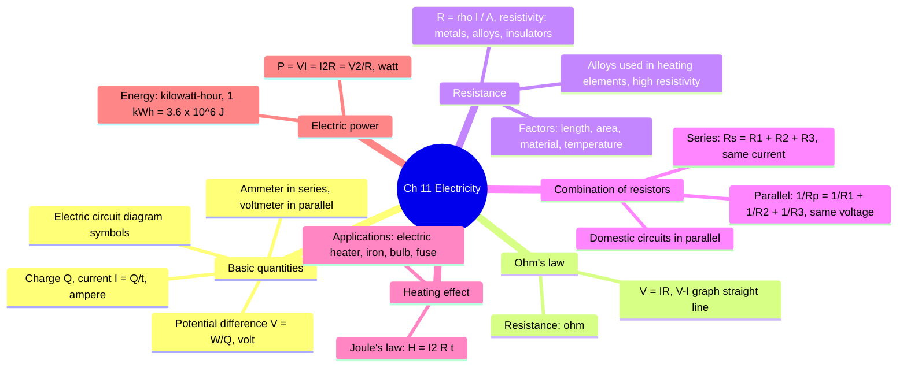

# Class X · Ch 11 — Electricity

*Physics* · विद्युत

## Basic quantities

- Charge Q; current I = Q/t; ampere
- Potential difference V = W/Q; volt
- Electric circuit diagram symbols
- Ammeter in series; voltmeter in parallel

## Ohm's law

- V = IR; V-I graph straight line
- Resistance: ohm

## Resistance

- Factors: length, area, material, temperature
- R = rho l / A; resistivity: metals, alloys, insulators
- Alloys used in heating elements, high resistivity

## Combination of resistors

- Series: Rs = R1 + R2 + R3; same current
- Parallel: 1/Rp = 1/R1 + 1/R2 + 1/R3; same voltage
- Domestic circuits in parallel

## Heating effect

- Joule's law: H = I2 R t
- Applications: electric heater, iron, bulb, fuse

## Electric power

- P = VI = I2R = V2/R; watt
- Energy: kilowatt-hour; 1 kWh = 3.6 x 10^6 J

## Visual lessons in the app

- Ohm's law circuit
- Factors affecting resistance
- Resistors in series & parallel
- Heating effect & power
