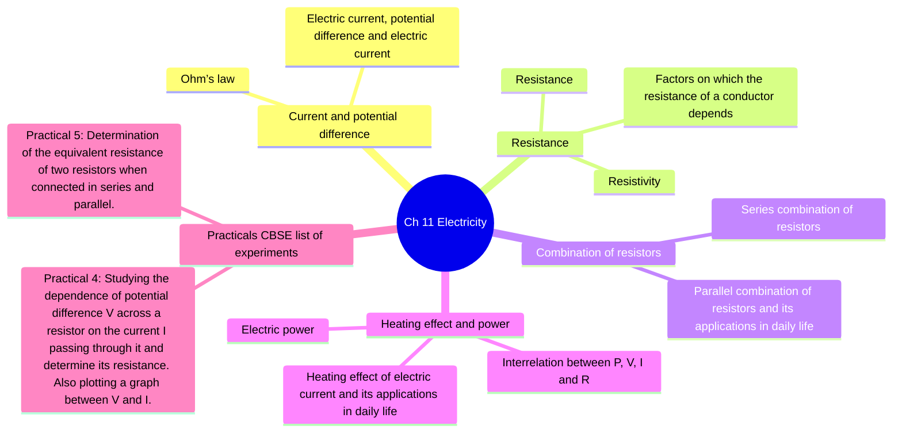

# Class X · Ch 11 — Electricity

*Unit IV · Effects of Current (13 marks)* · विद्युत

## Current and potential difference _(CBSE key concept)_

- Electric current, potential difference and electric current
- Ohm’s law

## Resistance _(CBSE key concept)_

- Resistance
- Resistivity
- Factors on which the resistance of a conductor depends

## Combination of resistors _(CBSE key concept)_

- Series combination of resistors
- Parallel combination of resistors and its applications in daily life

## Heating effect and power _(CBSE key concept)_

- Heating effect of electric current and its applications in daily life
- Electric power
- Interrelation between P, V, I and R

## Practicals (CBSE list of experiments) _(CBSE practical)_

- Practical 4: Studying the dependence of potential difference (V) across a resistor on the current (I) passing through it and determine its resistance. Also plotting a graph between V and I.
- Practical 5: Determination of the equivalent resistance of two resistors when connected in series and parallel.

## Visual lessons in the app

- Ohm's law circuit
- Factors affecting resistance
- Resistors in series & parallel
- Heating effect & power
