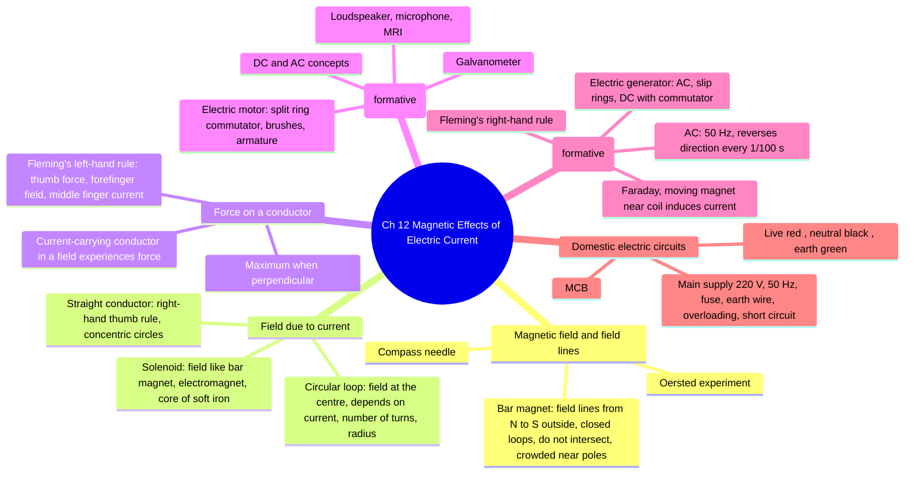

# Class X · Ch 12 — Magnetic Effects of Electric Current

*Physics* · विद्युत धारा के चुंबकीय प्रभाव

## Magnetic field and field lines

- Oersted experiment
- Bar magnet: field lines from N to S outside; closed loops; do not intersect; crowded near poles
- Compass needle

## Field due to current

- Straight conductor: right-hand thumb rule; concentric circles
- Circular loop: field at the centre; depends on current, number of turns, radius
- Solenoid: field like bar magnet; electromagnet; core of soft iron

## Force on a conductor

- Current-carrying conductor in a field experiences force
- Fleming's left-hand rule: thumb force, forefinger field, middle finger current
- Maximum when perpendicular

## Applications _(formative-only in 2026–27; not in year-end exam)_

- Electric motor: split ring commutator, brushes, armature
- Loudspeaker, microphone, MRI
- Galvanometer
- DC and AC concepts

## Electromagnetic induction _(formative-only in 2026–27; not in year-end exam)_

- Faraday; moving magnet near coil induces current
- Fleming's right-hand rule
- Electric generator: AC; slip rings; DC with commutator
- AC: 50 Hz, reverses direction every 1/100 s

## Domestic electric circuits

- Live (red), neutral (black), earth (green)
- Main supply 220 V, 50 Hz; fuse; earth wire; overloading; short circuit
- MCB

## Visual lessons in the app

- Bar magnet: field lines
- Field around a straight wire
- Electromagnetic induction
- Circular loop & solenoid
- Force on a conductor (Fleming's left-hand rule)
- Domestic electric circuits
- Electric motor & generator (Reading Material)
