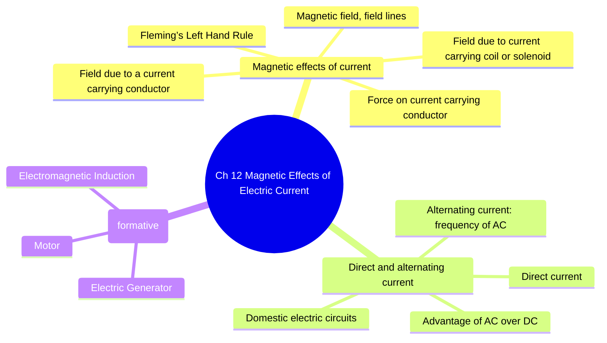

# Class X · Ch 12 — Magnetic Effects of Electric Current

*Unit IV · Effects of Current (13 marks)* · विद्युत धारा के चुंबकीय प्रभाव

## Magnetic effects of current _(CBSE key concept)_

- Magnetic field, field lines
- Field due to a current carrying conductor
- Field due to current carrying coil or solenoid
- Force on current carrying conductor
- Fleming’s Left Hand Rule

## Direct and alternating current _(CBSE key concept)_

- Direct current
- Alternating current: frequency of AC
- Advantage of AC over DC
- Domestic electric circuits

## Motor, Electromagnetic Induction, Electric Generator _(formative-only in 2026–27; not in year-end exam)_

- Motor
- Electromagnetic Induction
- Electric Generator

## Visual lessons in the app

- Bar magnet: field lines
- Field around a straight wire
- Electromagnetic induction
- Circular loop & solenoid
- Force on a conductor (Fleming's left-hand rule)
- Domestic electric circuits
- Electric motor & generator (Reading Material)
- AC vs DC and frequency
