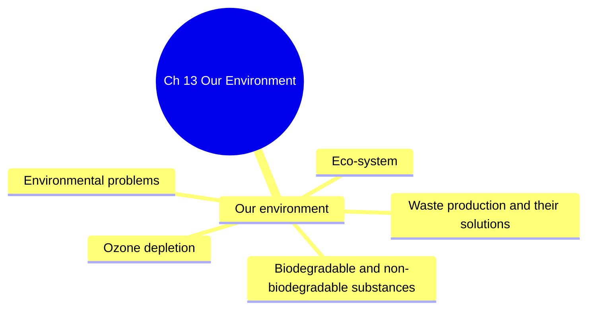

# Class X · Ch 13 — Our Environment

*Unit V · Natural Resources (5 marks)* · हमारा पर्यावरण

## Our environment _(CBSE key concept)_

- Eco-system
- Environmental problems
- Ozone depletion
- Waste production and their solutions
- Biodegradable and non-biodegradable substances

## Visual lessons in the app

- Energy flow & 10% law
- Food web
- Ozone layer depletion
- Biodegradable vs non-biodegradable
